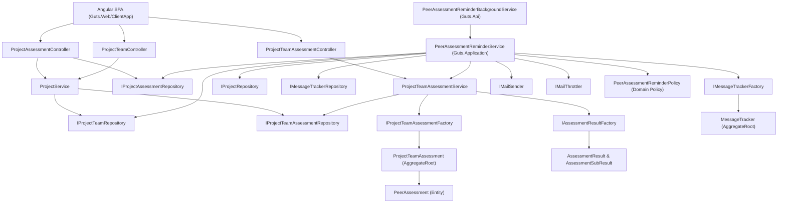

# Technical Design: Project Team Peer Assessments

- **Feature ID**: `001-peer-assessments`
- **Specification**: [`spec.md`](./spec.md)
- **Status**: `Implemented`

---

## 1. Architectural Overview

The Peer Assessments feature spans five domain aggregates/value-object clusters (`ProjectAggregate`, `ProjectTeamAggregate`, `ProjectTeamAssessmentAggregate`, `AssessmentResultAggregate`, and `MessageTrackerAggregate`), orchestrated by `ProjectTeamAssessmentService`, `ProjectService`, and `PeerAssessmentReminderService`, persisted via EF Core repositories, and exposed through REST controllers plus a dedicated background service (`PeerAssessmentReminderBackgroundService`), consumed by the Angular SPA and email notifications.



---

## 2. Domain Layer (`Guts.Domain`)

### Aggregates, Entities & Value Objects

1. **`AssessmentScore` (`Guts.Domain/ValueObjects/AssessmentScore.cs`)**
   - Inherits from `ValueObject<AssessmentScore>`.
   - Static instances: `NullScore (-1)`, `NoAddedValue (0)`, `WayBelowAverage (1)`, `BelowAverage (2)`, `Average (3)`, `AboveAverage (4)`, `WayAboveAverage (5)`.
   - Implicit conversions between `int`, `double` (rounded via `MidpointRounding.AwayFromZero`), and `AssessmentScore`.

2. **`ProjectAssessment` (`Guts.Domain/TopicAggregate/ProjectAggregate/ProjectAssessment.cs`)**
   - Entity defining an assessment milestone for a `Project` (`ProjectId`, `Description`, `OpenOnUtc`, `DeadlineUtc`).
   - Created via `ProjectAssessment.Factory` (`IProjectAssessmentFactory`) and mutated via `Update(...)`.

3. **`ProjectTeamAssessment` & `IProjectTeamAssessment` (`Guts.Domain/ProjectTeamAssessmentAggregate/`)**
   - `AggregateRoot` linking an `IProjectAssessment` and an `IProjectTeam`.
   - Holds `HashSet<User> _peers` exposed as `IReadOnlyCollection<User> Peers` (`[DR-3]`, `[DR-4]`, `[AC-2]`) — initialized by copying `team.TeamUsers.Select(tu => tu.User)` in `ProjectTeamAssessment.Factory.CreateNew`.
   - Holds `HashSet<IPeerAssessment> _peerAssessments` exposed as `IReadOnlyCollection<IPeerAssessment> PeerAssessments`.
   - **`bool IsComplete`** (`[DR-5]`):
     - Returns `true` strictly when `_peers.Count >= 2 && _peerAssessments.Count == _peers.Count * _peers.Count`.
     - Requires at least 2 peers ($N \ge 2$); a 1-person assessment ($N < 2$) never evaluates to `IsComplete == true`.
   - **Domain Methods**:
     - `User GetPeer(int userId)` (`[DR-4]`, `[DR-8]`):
       - Returns the matching `User` from `_peers`, or throws `ContractException` (`"The user with id '{userId}' is not a peer in this team assessment."`).
     - `void AddPeer(int userId)` (`[AC-9]`, `[DR-4]`, `[DR-10]`):
       - Enforces `Contracts.Require(!IsComplete, "The team assessment is completed by all peers. It is not possible anymore to add or remove peers.");`.
       - Resolves `User user = Team.GetTeamUser(userId);` (throws `ContractException` if the user is not a current member of `Team.TeamUsers`).
       - If `_peers.All(p => p.Id != userId)`, adds `user` to `_peers`.
     - `IReadOnlyList<IPeerAssessment> RemovePeer(int userId)` (`[AC-8]`, `[AC-9]`, `[DR-4]`, `[DR-10]`):
       - Enforces `Contracts.Require(!IsComplete, "The team assessment is completed by all peers. It is not possible anymore to add or remove peers.");`.
       - Removes any `User` with `Id == userId` from `_peers`.
       - Removes all `IPeerAssessment` entries from `_peerAssessments` where `pa.User.Id == userId || pa.Subject.Id == userId` and returns the removed `IPeerAssessment` list.
     - `void SetPeerInclusion(int userId, bool isIncluded)` (`[AC-9]`, `[DR-4]`):
       - Enforces `Contracts.Require(!IsComplete, "The team assessment is completed by all peers. It is not possible anymore to add or remove peers.");`.
       - Enforces `Team.GetTeamUser(userId)` (user must be a current member of `Team.TeamUsers`).
       - If `isIncluded`: calls `AddPeer(userId)`.
       - If `!isIncluded`: calls `RemovePeer(userId)`.
     - `AddOrUpdatePeerAssessment(...)`, `GetPeerAssessmentsOf(userId)`, `GetMissingPeerAssessmentsOf(userId)`, `GetPeersThatNeedToEvaluateOthers()`, and `ValidateAssessmentsOf(userId)`:
       - Operate against `Peers` / `GetPeer(userId)` rather than `Team.TeamUsers`.

4. **`PeerAssessment` (`Guts.Domain/ProjectTeamAssessmentAggregate/PeerAssessment.cs`)**
   - `Entity` representing a single evaluation by `User` (evaluator) about `Subject` (teammate) within a `ProjectTeamAssessment`.

5. **`AssessmentResult` & `AssessmentSubResult` (`Guts.Domain/AssessmentResultAggregate/`)**
   - **`AssessmentResult.Factory.Create(int subjectId, IProjectTeamAssessment projectTeamAssessment, bool includePeerAssessments)`** (`[AC-6]`, `[DR-8]`):
     - When `includePeerAssessments == false` (Student requesting `/my-result`): requires `subjectId` to be a current member of `projectTeamAssessment.Team.TeamUsers` (`projectTeamAssessment.Team.GetTeamUser(subjectId)`) AND a peer in `projectTeamAssessment.Peers` (`projectTeamAssessment.GetPeer(subjectId)`), preventing removed team members from accessing team results.
     - When `includePeerAssessments == true` (Teacher requesting `/detailed-results`): resolves `User subject = projectTeamAssessment.GetPeer(subjectId)`, allowing results to be generated for all peers in `projectTeamAssessment.Peers` (including members later removed from `Team.TeamUsers`).

6. **`MessageTracker` & `IMessageTracker` (`Guts.Domain/MessageTrackerAggregate/`)** (`[DR-12]`, `[AC-11]`)
   - `MessageTracker` inherits from `Entity` and implements `IMessageTracker : IEntity`, representing delivery tracking and idempotency for outgoing automated messages.
   - Identified by its composite identity via `GetIdComponents()`: `(EntityType, EntityId, Email)` (no surrogate `Id` property).
   - **Properties**:
     - `string EntityType { get; }` (max 64 characters, e.g. `"PeerAssessment"`)
     - `int EntityId { get; }` (e.g. `ProjectAssessment.Id`)
     - `Email Email { get; }` (`Email` Value Object)
     - `MessageStatus Status { get; }` (`Sending`, `Succeeded`, `Failed`)
     - `DateTime CreatedAtUtc { get; }`
     - `DateTime SentAtUtc { get; }`
     - `int RetryCount { get; }` (defaults to `0`, max `3`)
     - `string FailureReason { get; }` (optional error detail)
     - `bool CanRetry => Status == MessageStatus.Failed && RetryCount < 3;`
   - **Invariants (`Contracts.Require`)**:
     - Non-empty `EntityType` (trimmed, max 64 characters) and non-null `Email`.
     - Positive `EntityId`.
     - `DateTimeKind.Utc` on all date properties.
   - **State Transitions**:
     - `void MarkSucceeded()`:
       - Enforces `Contracts.Require(Status == MessageStatus.Sending, "MarkSucceeded can only follow a Sending status.");`.
       - Sets `Status = MessageStatus.Succeeded` and clears `FailureReason` (`FailureReason = null`).
     - `void MarkFailed(string reason)`:
       - Enforces `Contracts.Require(Status == MessageStatus.Sending, "MarkFailed can only follow a Sending status.");`.
       - Sets `Status = MessageStatus.Failed`, increments `RetryCount` by 1, and sets `FailureReason = reason`.
     - `void Retry(DateTime sentAtUtc)`:
       - Enforces `Contracts.Require(CanRetry, "Cannot retry this message because it is not in a failed state or the maximum retry count has been reached.");`.
       - Enforces `Contracts.Require(sentAtUtc.Kind == DateTimeKind.Utc, "The retry timestamp must be a UTC date.");`.
       - Transitions `Status` back to `MessageStatus.Sending`, updates `SentAtUtc = sentAtUtc`, and always clears `FailureReason` (`FailureReason = null`).

7. **`MessageStatus` (`Guts.Domain/MessageTrackerAggregate/MessageStatus.cs`)**
   - Enum: `Sending = 1`, `Succeeded = 2`, `Failed = 3`.

8. **`MessageTrackerFactory` & `IMessageTrackerFactory` (`Guts.Domain/MessageTrackerAggregate/`)**
   - `IMessageTracker CreateNew(string entityType, int entityId, Email email, DateTime nowUtc)`:
     - Validates parameters via `Contracts.Require`.
     - Instantiates `MessageTracker` with `Status = MessageStatus.Sending`, `CreatedAtUtc = nowUtc`, `SentAtUtc = nowUtc`, `RetryCount = 0`, `FailureReason = null`.

9. **`PeerAssessmentReminderPolicy` (`Guts.Domain/TopicAggregate/ProjectAggregate/PeerAssessmentReminderPolicy.cs`)** (`[DR-13]`, `[AC-10]`)
   - Pure static domain policy evaluating assessment eligibility:
     ```csharp
     public static bool IsAssessmentEligibleForReminders(IProjectAssessment assessment, DateTime nowUtc)
     {
         if (assessment == null) return false;
         bool isOpen = assessment.OpenOnUtc <= nowUtc && nowUtc < assessment.DeadlineUtc;
         bool hasMinimumDuration = (assessment.DeadlineUtc - assessment.OpenOnUtc) >= TimeSpan.FromHours(48);
         bool isWithinFinal24Hours = (assessment.DeadlineUtc - nowUtc) <= TimeSpan.FromHours(24);
         return isOpen && hasMinimumDuration && isWithinFinal24Hours;
     }
     ```

---

## 3. Business Layer (`Guts.Application`)

### Repository Contracts (`Guts.Application/Repositories/`)
- `IProjectAssessmentRepository`:
  - `Task<IReadOnlyList<IProjectAssessment>> FindByProjectIdAsync(int projectId);`
  - `Task<IReadOnlyList<IProjectAssessment>> GetOpenAssessmentsAsync(DateTime nowUtc);`
- `IProjectRepository`:
  - `Task<IProject> LoadWithCourseAsync(int projectId);`
- `IProjectTeamAssessmentRepository`:
  - `Task<IProjectTeamAssessment> LoadAsync(int projectAssessmentId, int teamId);`
- `IMessageTrackerRepository`:
  - `Task<IMessageTracker> FindByEntityAndEmailAsync(string entityType, int entityId, string email);`
  - `Task<IReadOnlyList<IMessageTracker>> FindByEntityAsync(string entityType, int entityId);`
  - `Task<IMessageTracker> AddAsync(IMessageTracker messageTracker);`
  - `Task<IMessageTracker> UpdateAsync(IMessageTracker messageTracker);`

### Application Services (`Guts.Application/Services/`)
- **`IProjectTeamAssessmentService` / `ProjectTeamAssessmentService`** (`Guts.Application/Services/Assessment/`):
  - `GetOrCreateTeamAssessmentAsync(projectAssessmentId, projectTeamId)` — Loads existing `ProjectTeamAssessment` or provisions a new one via `IProjectTeamAssessmentFactory`.
  - `GetStatusAsync(projectAssessmentId, teamId)` — Returns `ProjectTeamAssessmentStatusDto` including `PeerIds` (`teamAssessment.Peers.Select(u => u.Id).ToList()`).
  - `GetResultsForTeacherAsync(projectAssessmentId, teamId)` (`[AC-6]`):
    - Iterates over `teamAssessment.Peers` (instead of `teamAssessment.Team.TeamUsers`) and invokes `assessmentResultFactory.Create(peer.Id, teamAssessment, true)`.
  - `GetResultForStudent(projectAssessmentId, teamId, userId)` — Invokes `assessmentResultFactory.Create(userId, teamAssessment, false)`.
  - `GetPeerAssessmentsOfUserAsync(projectAssessmentId, teamId, userId)` — Concatenates stored and missing `IPeerAssessment` records for the user.
  - `SavePeerAssessmentsOfUserAsync(projectAssessmentId, teamId, userId, peerAssessments)` — Applies each `PeerAssessmentDto`, invokes `ValidateAssessmentsOf(userId)`, and persists via `repository.UpdateAsync(...)`.
  - `Task SetPeerInclusionAsync(int projectAssessmentId, int teamId, int userId, bool isIncluded)` (`[AC-9]`):
    - Loads (or creates) the `ProjectTeamAssessment` via `GetOrCreateTeamAssessmentAsync(projectAssessmentId, teamId)`.
    - Calls `teamAssessment.SetPeerInclusion(userId, isIncluded)`.
    - Persists changes via `repository.UpdateAsync(teamAssessment)`.
- **`IPeerAssessmentReminderService` / `PeerAssessmentReminderService`** (`Guts.Application/Services/Assessment/`) (`[AC-10]`, `[AC-11]`, `[AC-13]`):
  - `Task<int> SendAssessmentRemindersAsync(DateTime executionTime, CancellationToken cancellationToken = default)`:
    - Loads open assessments via `_projectAssessmentRepository.GetOpenAssessmentsAsync(executionTime)`.
    - Filters assessments matching `PeerAssessmentReminderPolicy.IsAssessmentEligibleForReminders(assessment, executionTime)`.
    - For each eligible assessment:
      - Loads project and course via `_projectRepository.LoadWithCourseAsync(assessment.ProjectId)`.
      - Loads project teams via `_projectTeamRepository.GetByProjectWithUsersAsync(project.Id)`.
      - For each team with members:
        - Ensures team assessment is provisioned via `_projectTeamAssessmentService.GetOrCreateTeamAssessmentAsync(assessment.Id, team.Id)`.
        - Retrieves peers with pending evaluations via `teamAssessment.GetPeersThatNeedToEvaluateOthers()`.
        - For each peer with a valid email:
          - Queries `_messageTrackerRepository.FindByEntityAndEmailAsync("PeerAssessment", assessment.Id, peer.Email)`.
          - Skips if `tracker.Status == MessageStatus.Succeeded` or `tracker.RetryCount >= 3`.
          - If tracker exists and `tracker.CanRetry`:
            - Invokes `tracker.Retry(executionTime)` to transition status to `Sending` and persists update via `_messageTrackerRepository.UpdateAsync(tracker)`.
          - If tracker does not exist:
            - Creates new `MessageTracker` via `_messageTrackerFactory.CreateNew(...)` in `Sending` state and persists via `_messageTrackerRepository.AddAsync(...)`.
          - Dispatches email via `_mailSender.SendPeerAssessmentReminderEmailAsync(...)`.
          - On success: invokes `tracker.MarkSucceeded()`, updates repository, and increments sent counter.
          - On failure: logs error, invokes `tracker.MarkFailed(ex.Message)`, and updates repository.
          - Delays between outgoing messages via `_mailThrottler.ThrottleAsync(cancellationToken)`.
    - Returns total count of successfully sent reminders.

### Communication & Anti-Spam Throttling (`Guts.Application/Communication/`)
- **`IMailThrottler` / `MailThrottler`** (`[AC-12]`):
  - Decoupled rate-limiting component defining `TimeSpan ThrottleDelay { get; set; }` and `Task ThrottleAsync(CancellationToken cancellationToken = default);`.
  - Configured via `Mail:ThrottleDelayInSeconds` (default: 1 second).
  - Used by both `StreakReminderService` and `PeerAssessmentReminderService` to guarantee consistent pacing without code duplication.
- **`IMailSender` / `MailSender`** (`[AC-13]`):
  - Extended with `Task SendPeerAssessmentReminderEmailAsync(User recipient, string courseName, int courseId, string projectCode, string projectDescription, IProjectAssessment assessment, int teamId)`.
  - Formats HTML email containing recipient greeting, project description, assessment description, UTC deadline, and direct link to `courses/{courseId}/projects/{projectCode}/assessments/{assessment.Id}/teams/{teamId}/evaluate`.

### DTOs (`Guts.Application/Dtos/`)
- `ProjectTeamAssessmentStatusDto`:
  - `Id`, `TeamId`, `IsComplete`, `PeersThatNeedToEvaluateOthers`, and **new property** `IReadOnlyList<int> PeerIds { get; set; }`.
- `PeerAssessmentDto` (`UserId`, `SubjectId`, `CooperationScore`, `ContributionScore`, `EffortScore`, `Explanation`)

---

## 4. Infrastructure Layer (`Guts.Infrastructure`)

### EF Core Configuration & Migrations
- **`ProjectTeamAssessmentConfiguration` (`Guts.Infrastructure/EntityConfigurations/ProjectTeamAssessmentConfiguration.cs`)**:
  - Maps `ProjectTeamAssessment.Peers` (backed by `_peers`) as a many-to-many relationship to `User` using join table `ProjectTeamAssessmentPeers`:
    ```csharp
    builder.HasMany(pta => pta.Peers)
        .WithMany()
        .UsingEntity<Dictionary<string, object>>(
            "ProjectTeamAssessmentPeers",
            j => j.HasOne<User>().WithMany().HasForeignKey("UserId").OnDelete(DeleteBehavior.Cascade),
            j => j.HasOne<ProjectTeamAssessment>().WithMany().HasForeignKey("ProjectTeamAssessmentId").OnDelete(DeleteBehavior.Cascade));
    builder.Metadata.FindNavigation(nameof(ProjectTeamAssessment.Peers)).SetPropertyAccessMode(PropertyAccessMode.Field);
    ```
- **`MessageTrackerConfiguration` (`Guts.Infrastructure/EntityConfigurations/MessageTrackerConfiguration.cs`)** (`[DR-12]`, `[AC-11]`):
  - Internal entity configuration mapping `MessageTracker` aggregate to table `MessageTrackers`:
    - Composite primary key: `builder.HasKey(mt => new { mt.EntityType, mt.EntityId, mt.Email });`
    - Column constraints:
      - `builder.Property(mt => mt.EntityType).IsRequired().HasMaxLength(MessageTracker.MaxEntityTypeLength);` (64 characters)
      - `builder.Property(mt => mt.EntityId).IsRequired();`
      - `builder.Property(mt => mt.Email).IsRequired().HasMaxLength(Email.MaxLength).HasConversion(e => e.ToString(), str => new Email(str));` (256 characters)
      - `builder.Property(mt => mt.Status).IsRequired();`
      - `builder.Property(mt => mt.CreatedAtUtc).IsRequired();`
      - `builder.Property(mt => mt.SentAtUtc).IsRequired();`
      - `builder.Property(mt => mt.RetryCount).IsRequired();`
      - `builder.Property(mt => mt.FailureReason).HasMaxLength(1024);`
- **Migration Required?**: `Yes`
  - 1. `ProjectTeamAssessmentPeers` migration (creates join table for peer collections).
  - 2. `AddMessageTrackers` migration (creates `MessageTrackers` table with composite primary key).

### Repository Implementations (`Guts.Infrastructure/Repositories/`)
- **`MessageTrackerDbRepository`** (`Guts.Infrastructure/Repositories/MessageTrackerDbRepository.cs`):
  - Internal class inheriting `BaseDbRepository<IMessageTracker, MessageTracker>` and implementing `IMessageTrackerRepository`:
    - `FindByEntityAndEmailAsync(string entityType, int entityId, Email email)`: queries `_context.MessageTrackers.FirstOrDefaultAsync(...)`.
    - `FindByEntityAsync(string entityType, int entityId)`: queries `_context.MessageTrackers.Where(...).ToListAsync()`.
    - Inherits `GetByIdAsync(params object[] idValues)`, `AddAsync`, `UpdateAsync`, etc., from `BaseDbRepository`.
- **`ProjectAssessmentDbRepository`**:
  - Extended with `GetOpenAssessmentsAsync(DateTime nowUtc)`:
    - Queries `_context.Set<ProjectAssessment>().Where(pa => pa.OpenOnUtc <= nowUtc && pa.DeadlineUtc > nowUtc).ToListAsync()`.
- **`ProjectDbRepository`**:
  - Extended with `LoadWithCourseAsync(int projectId)`:
    - Queries `_context.Projects.Include(p => p.Course).FirstOrDefaultAsync(p => p.Id == projectId)`.
- **`ProjectTeamAssessmentDbRepository`**:
  - `LoadAsync(projectAssessmentId, teamId)` eagerly loads:
    - `Team.TeamUsers` -> `ThenInclude(tu => tu.User)`
    - `ProjectAssessment`
    - `Peers`
    - `PeerAssessments` -> `ThenInclude(pa => pa.User)`
    - `PeerAssessments` -> `ThenInclude(pa => pa.Subject)`
  - `UpdateAsync(IProjectTeamAssessment existingEntity)`:
    - Ensures any `PeerAssessment` removed from `existingEntity.PeerAssessments` (e.g., when a Teacher excludes a peer via `SetPeerInclusion(userId, false)`) is deleted from `_context.PeerAssessments` before `SaveChangesAsync()`.
- **`ProjectTeamDbRepository`**:
  - `AddUserToTeam(int teamId, int userId)` (`[AC-9]`, `[DR-10]`):
    - Adds the `ProjectTeamUser` to `_context.ProjectTeamUsers` and saves (or loads the user into `Team.TeamUsers`).
    - Loads all `ProjectTeamAssessment` aggregates for `teamId` (including `Team.TeamUsers.User`, `ProjectAssessment`, `Peers`, and `PeerAssessments`).
    - For each `teamAssessment` where `!teamAssessment.IsComplete && DateTime.UtcNow <= teamAssessment.ProjectAssessment.DeadlineUtc`, invokes `teamAssessment.AddPeer(userId)`.
  - `RemoveUserFromTeam(int teamId, int userId)` (`[AC-8]`, `[DR-10]`):
    - Loads the `ProjectTeamUser` (throws `ContractException` if not found).
    - Loads all `ProjectTeamAssessment` aggregates for `teamId` (including `Team.TeamUsers.User`, `ProjectAssessment`, `Peers`, and `PeerAssessments` with `User` and `Subject`).
    - For each `teamAssessment` where `!teamAssessment.IsComplete`, invokes `teamAssessment.RemovePeer(userId)` and marks the returned `IPeerAssessment` records as `EntityState.Deleted`. Completed assessments (`teamAssessment.IsComplete == true`) are left untouched.
    - Marks the `ProjectTeamUser` as `EntityState.Deleted` and saves changes.

---

## 5. API & Background Services Layer (`Guts.Api`)

### REST Endpoints (`Guts.Api/Controllers/`)

1. **`ProjectAssessmentController` (`/api/project-assessments`)**
   - Unchanged.

2. **`ProjectTeamAssessmentController` (`/api/project-team-assessments`)**
   - `GET of-project-assessment/{projectAssessmentId}/of-team/{teamId}/status` — Returns `ProjectTeamAssessmentStatusDto` (now including `PeerIds`).
   - `GET of-project-assessment/{projectAssessmentId}/of-team/{teamId}/peer-assessments` — Get current user's stored + placeholder peer evaluations.
   - `POST of-project-assessment/{projectAssessmentId}/of-team/{teamId}/peer-assessments` — Save current user's peer evaluations.
   - `GET of-project-assessment/{projectAssessmentId}/of-team/{teamId}/detailed-results` (`LectorsOnlyPolicy`) — Get full team assessment results including individual peer evaluations.
   - `GET of-project-assessment/{projectAssessmentId}/of-team/{teamId}/my-result` — Get current student's summary result.
   - `PUT of-project-assessment/{projectAssessmentId}/of-team/{teamId}/peers/{userId}/inclusion` (`[Authorize(Policy = ApiConstants.LectorsOnlyPolicy)]`) (`[AC-9]`):
     - Request Body: `[FromBody] bool isIncluded`
     - Calls `projectTeamAssessmentService.SetPeerInclusionAsync(projectAssessmentId, teamId, userId, isIncluded)` and returns `200 OK`.

### Background Services (`Guts.Api/BackgroundServices/`)
- **`PeerAssessmentReminderBackgroundService`** (`[AC-10]`):
  - Inherits from `Microsoft.Extensions.Hosting.BackgroundService`.
  - Constructor injects `IServiceScopeFactory`, `IConfiguration`, `ILogger<PeerAssessmentReminderBackgroundService>`, and optional `TimeProvider`.
  - Reads check interval from configuration: `Configuration.GetValue<int>("PeerAssessmentReminders:CheckIntervalInHours", 2)`.
  - While running, awaits the delay interval, creates a service scope, resolves `IPeerAssessmentReminderService`, and executes `SendAssessmentRemindersAsync(executionTime, stoppingToken)`.
- **Hosted Service Registration (`Guts.Api/Startup.cs`)**:
  - `services.AddHostedService<PeerAssessmentReminderBackgroundService>();`
- **Configuration (`Guts.Api/appsettings.json`)**:
  ```json
  "PeerAssessmentReminders": {
    "CheckIntervalInHours": 2
  },
  "Mail": {
    "ThrottleDelayInSeconds": 1
  }
  ```

---

## 6. Frontend Layer (`Guts.Web/ClientApp`)

### Services & ViewModels
- **`projectassessment.model.ts`**:
  - Extend `IProjectTeamAssessmentStatusModel` and `ProjectTeamAssessmentStatusModel` with `peerIds: number[]`.
- **`ProjectTeamAssessmentService` (`src/app/services/project.teamassessment.service.ts`)**:
  - Add `setPeerInclusion(projectAssessmentId: number, teamId: number, userId: number, isIncluded: boolean): Observable<PostResult>` calling `PUT api/project-team-assessments/of-project-assessment/${projectAssessmentId}/of-team/${teamId}/peers/${userId}/inclusion`.

### Components (`src/app/components/`)
- **`ProjectTeamEditComponent` (`src/app/components/project-team-edit/`)** (`[AC-9]`):
  - Accepts `@Input() openAssessments: IProjectAssessmentModel[]` (or loads open assessments for the project) and fetches team assessment statuses (`getProjectTeamAssessmentStatus`).
  - Filters to incomplete assessments (`!status.isComplete`).
  - For each team member in `team.members`, renders an inclusion checkbox per incomplete open assessment allowing the Teacher to include or exclude that peer (`isPeerIncluded(assessment, member)` / `togglePeerInclusion(assessment, member, isIncluded)`).
  - Updates the removal confirmation prompt in `ProjectTeamEditComponent` and `ProjectTeamComponent` to clarify that only open/incomplete peer assessments are deleted when a member leaves or is removed.

---

## 7. Dependency Injection (`Guts.Bootstrapper`)

- **Explicit Registrations (`Guts.Bootstrapper/StartUpExtensions.cs`)**:
  - `IMailThrottler`: registered as a singleton or scoped service reading `Mail:ThrottleDelayInSeconds` from `IConfiguration`.
- **Automatic Registrations (Convention-Based via `StartUpExtensions.cs`)**:
  - `MessageTrackerFactory` implements `IMessageTrackerFactory` in `Guts.Domain` (ends with `Factory` ➔ Singleton).
  - `PeerAssessmentReminderService` implements `IPeerAssessmentReminderService` in `Guts.Application` (ends with `Service` ➔ Scoped).
  - `MessageTrackerDbRepository` implements `IMessageTrackerRepository` in `Guts.Infrastructure` (ends with `Repository` ➔ Scoped).
