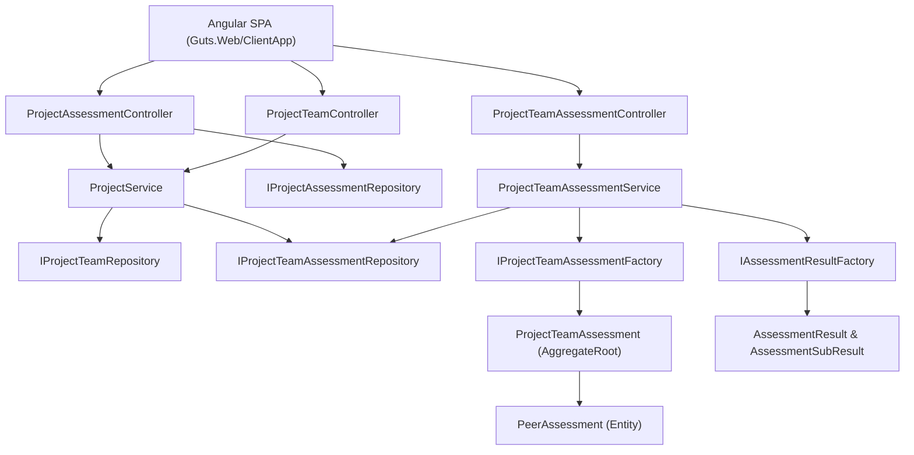

# Technical Design: Project Team Peer Assessments

- **Feature ID**: `001-peer-assessments`
- **Specification**: [`spec.md`](./spec.md)
- **Status**: `Draft` (Extended with Team Membership Changes)

---

## 1. Architectural Overview

The Peer Assessments feature spans four domain aggregates/value-object clusters (`ProjectAggregate`, `ProjectTeamAggregate`, `ProjectTeamAssessmentAggregate`, and `AssessmentResultAggregate`), orchestrated by `ProjectTeamAssessmentService` and `ProjectService`, persisted via EF Core repositories, and exposed through two REST controllers (`ProjectAssessmentController` and `ProjectTeamAssessmentController`) plus `ProjectTeamController`, consumed by the Angular SPA.

---

## 2. Domain Layer (`Guts.Domain`)

### Aggregates, Entities & Value Objects

1. **`AssessmentScore` (`Guts.Domain/ValueObjects/AssessmentScore.cs`)**
   - Inherits from `ValueObject<AssessmentScore>`.
   - Static instances: `NullScore (-1)`, `NoAddedValue (0)`, `WayBelowAverage (1)`, `BelowAverage (2)`, `Average (3)`, `AboveAverage (4)`, `WayAboveAverage (5)`.
   - Implicit conversions between `int`, `double` (rounded via `MidpointRounding.AwayFromZero`), and `AssessmentScore`.

2. **`ProjectAssessment` (`Guts.Domain/TopicAggregate/ProjectAggregate/ProjectAssessment.cs`)**
   - Entity defining an assessment milestone for a `Project` (`ProjectId`, `Description`, `OpenOnUtc`, `DeadlineUtc`).
   - Created via `ProjectAssessment.Factory` (`IProjectAssessmentFactory`) and mutated via `Update(...)`.

3. **`ProjectTeamUser` & `IProjectTeamUser` (`Guts.Domain/ProjectTeamAggregate/`)**
   - **Modified Property** (`[DR-10]`, `[AC-9]`):
     - `DateTime JoinedOnUtc { get; set; } = DateTime.SpecifyKind(DateTime.MinValue, DateTimeKind.Utc);`
     - Defaults to `DateTime.MinValue` (UTC) for existing/seeded records so pre-existing members are treated as having joined prior to any `ProjectAssessment.OpenOnUtc`, and is explicitly set to `DateTime.UtcNow` when a user joins a team at runtime.

4. **`ProjectTeamAssessment` & `IProjectTeamAssessment` (`Guts.Domain/ProjectTeamAssessmentAggregate/`)**
   - `AggregateRoot` linking an `IProjectAssessment` and an `IProjectTeam`.
   - Holds `HashSet<IPeerAssessment> _peerAssessments` exposed as `IReadOnlyCollection<IPeerAssessment> PeerAssessments`.
   - **New State & Properties** (`[DR-4]`, `[DR-5]`, `[AC-5]`, `[AC-8]`, `[AC-9]`):
     - `DateTime? CompletedOnUtc { get; private set; }` — Set to `DateTime.UtcNow` as soon as the assessment reaches completion (`IsComplete` transitions to `true`), permanently locking the assessment as a historical snapshot.
     - `HashSet<int> _includedUserIds` and `HashSet<int> _excludedUserIds` — Track Teacher overrides for late-joining team members (`JoinedOnUtc > ProjectAssessment.OpenOnUtc`) while the assessment is incomplete.
     - `bool IsComplete` (`[DR-5]`):
       - Returns `true` if `CompletedOnUtc.HasValue`, OR if `_peerAssessments` forms a complete $M \times M$ evaluation matrix ($M \ge 2$) matching all currently eligible participants (`GetParticipants()`).
       - Requires at least 2 participants ($N \ge 2$); a 1-person team ($N < 2$) never evaluates to `IsComplete == true`.
   - **Updated & New Domain Methods**:
     - `IReadOnlyList<User> GetParticipants()` (`[DR-4]`, `[AC-5]`, `[AC-6]`):
       - If `IsComplete == true`: returns the distinct subjects stored in `_peerAssessments` (`_peerAssessments.Select(pa => pa.Subject).DistinctBy(u => u.Id).ToList()`), preserving removed members and excluding users who joined after completion.
       - If `IsComplete == false`: returns the eligible members from `Team.TeamUsers` where `IsUserEligibleParticipant(teamUser)` is `true`:
         1. If `teamUser.JoinedOnUtc <= ProjectAssessment.OpenOnUtc` ➔ `true`.
         2. If `_excludedUserIds.Contains(teamUser.UserId)` ➔ `false`.
         3. If `_includedUserIds.Contains(teamUser.UserId)` ➔ `true`.
         4. Otherwise ➔ `teamUser.JoinedOnUtc <= ProjectAssessment.DeadlineUtc`.
     - `User GetParticipant(int userId)` (`[DR-4]`, `[DR-8]`):
       - Returns the matching `User` from `GetParticipants()`, or throws `ContractException` if the user is not a participant of this `ProjectTeamAssessment`.
     - `void SetMemberInclusion(int userId, bool isIncluded)` (`[AC-9]`, `[DR-4]`, `[DR-11]`):
       - Enforces `Contracts.Require(!IsComplete, "The team assessment is completed by all peers. It is not possible anymore to change member inclusion.");`.
       - Enforces that `userId` is in `Team.TeamUsers` and `teamUser.JoinedOnUtc > ProjectAssessment.OpenOnUtc`.
       - When `isIncluded == true`: adds `userId` to `_includedUserIds` and removes from `_excludedUserIds`.
       - When `isIncluded == false`: adds `userId` to `_excludedUserIds`, removes from `_includedUserIds`, removes all `IPeerAssessment` entries in `_peerAssessments` where `pa.User.Id == userId || pa.Subject.Id == userId`, and updates `CompletedOnUtc` if the remaining $N \ge 2$ eligible participants have now completed all $N \times N$ evaluations.
     - `IReadOnlyList<IPeerAssessment> RemoveUserFromAssessment(int userId)` (`[AC-8]`, `[DR-11]`):
       - If `IsComplete == true`: returns an empty list and leaves `_peerAssessments` and `CompletedOnUtc` untouched.
       - If `IsComplete == false`: removes `userId` from `_includedUserIds` and `_excludedUserIds`, removes all `IPeerAssessment` entries from `_peerAssessments` where `pa.User.Id == userId || pa.Subject.Id == userId`, updates `CompletedOnUtc` if the remaining $N \ge 2$ eligible participants (excluding `userId`) have completed all $N \times N$ evaluations, and returns the removed `IPeerAssessment` list.
     - `AddOrUpdatePeerAssessment(...)`, `GetPeerAssessmentsOf(userId)`, `GetMissingPeerAssessmentsOf(userId)`, `GetPeersThatNeedToEvaluateOthers()`, and `ValidateAssessmentsOf(userId)`:
       - Updated to validate and operate against `GetParticipants()` (eligible participants) rather than raw `Team.TeamUsers`, and `AddOrUpdatePeerAssessment` sets `CompletedOnUtc = DateTime.UtcNow` when the final required evaluation is added.

5. **`PeerAssessment` (`Guts.Domain/ProjectTeamAssessmentAggregate/PeerAssessment.cs`)**
   - `Entity` representing a single evaluation by `User` (evaluator) about `Subject` (teammate) within a `ProjectTeamAssessment`.

6. **`AssessmentResult` & `AssessmentSubResult` (`Guts.Domain/AssessmentResultAggregate/`)**
   - **`AssessmentResult.Factory.Create(int subjectId, IProjectTeamAssessment projectTeamAssessment, bool includePeerAssessments)`** (`[AC-6]`, `[DR-8]`):
     - When `includePeerAssessments == false` (Student requesting `/my-result`): requires `subjectId` to be a current member of `projectTeamAssessment.Team.TeamUsers` (`projectTeamAssessment.Team.GetTeamUser(subjectId)`), preventing removed team members from accessing team results.
     - When `includePeerAssessments == true` (Teacher requesting `/detailed-results`): resolves `User subject = projectTeamAssessment.GetParticipant(subjectId)`, allowing results to be generated for all participants of a completed assessment (including members later removed from the team).

---

## 3. Business Layer (`Guts.Business`)

### Repository Contracts (`Guts.Business/Repositories/`)
- `IProjectAssessmentRepository`:
  - `Task<IReadOnlyList<IProjectAssessment>> FindByProjectIdAsync(int projectId);`
- `IProjectTeamAssessmentRepository`:
  - `Task<IProjectTeamAssessment> LoadAsync(int projectAssessmentId, int teamId);`
  - `Task<IReadOnlyList<IProjectTeamAssessment>> FindByTeamIdAsync(int teamId);` *(or handled within repository cleanup on member removal)*

### Application Services (`Guts.Business/Services/`)
- **`IProjectTeamAssessmentService` / `ProjectTeamAssessmentService`** (`Guts.Business/Services/Assessment/`):
  - `GetOrCreateTeamAssessmentAsync(projectAssessmentId, projectTeamId)` — Loads existing `ProjectTeamAssessment` or provisions a new one via `IProjectTeamAssessmentFactory`.
  - `GetStatusAsync(projectAssessmentId, teamId)` — Returns `ProjectTeamAssessmentStatusDto` including `EligibleUserIds` (`teamAssessment.GetParticipants().Select(u => u.Id).ToList()`).
  - `GetResultsForLectorAsync(projectAssessmentId, teamId)` (`[AC-6]`):
    - Iterates over `teamAssessment.GetParticipants()` (instead of `teamAssessment.Team.TeamUsers`) and invokes `assessmentResultFactory.Create(participant.Id, teamAssessment, true)`.
  - `GetResultForStudent(projectAssessmentId, teamId, userId)` — Invokes `assessmentResultFactory.Create(userId, teamAssessment, false)`.
  - `GetPeerAssessmentsOfUserAsync(projectAssessmentId, teamId, userId)` — Concatenates stored and missing `IPeerAssessment` records for the user.
  - `SavePeerAssessmentsOfUserAsync(projectAssessmentId, teamId, userId, peerAssessments)` — Applies each `PeerAssessmentDto`, invokes `ValidateAssessmentsOf(userId)`, and persists via `repository.UpdateAsync(...)`.
  - **New Method**: `Task SetMemberInclusionAsync(int projectAssessmentId, int teamId, int userId, bool isIncluded)` (`[AC-9]`):
    - Loads (or creates) the `ProjectTeamAssessment` via `GetOrCreateTeamAssessmentAsync(projectAssessmentId, teamId)`.
    - Calls `teamAssessment.SetMemberInclusion(userId, isIncluded)`.
    - Persists changes via `repository.UpdateAsync(teamAssessment)`.

### DTOs (`Guts.Business/Dtos/`)
- `ProjectTeamAssessmentStatusDto`:
  - `Id`, `TeamId`, `IsComplete`, `PeersThatNeedToEvaluateOthers`, and **new property** `IReadOnlyList<int> EligibleUserIds { get; set; }`.
- `PeerAssessmentDto` (`UserId`, `SubjectId`, `CooperationScore`, `ContributionScore`, `EffortScore`, `Explanation`)

---

## 4. Infrastructure Layer (`Guts.Infrastructure`)

### EF Core Configuration & Migrations
- **`ProjectTeamConfiguration` / `ProjectTeamUser`**:
  - Maps `ProjectTeamUser.JoinedOnUtc` (required `DateTime`, converted via `UtcDateTimeConverter`).
- **`ProjectTeamAssessmentConfiguration` (`Guts.Infrastructure/EntityConfigurations/ProjectTeamAssessmentConfiguration.cs`)**:
  - Maps `CompletedOnUtc` (`DateTime?`).
  - Maps private fields `_includedUserIds` (`Column("IncludedUserIds")`) and `_excludedUserIds` (`Column("ExcludedUserIds")`) using a `ValueConverter<HashSet<int>, string>` (comma-separated integer IDs) with a `ValueComparer<HashSet<int>>`.
- **Migration Required?**: `Yes`
  - Migration adds `JoinedOnUtc` to `ProjectTeamUsers` and `CompletedOnUtc`, `IncludedUserIds`, `ExcludedUserIds` to `ProjectTeamAssessments`.

### Repository Implementations (`Guts.Infrastructure/Repositories/`)
- **`ProjectTeamAssessmentDbRepository`**:
  - `LoadAsync(projectAssessmentId, teamId)` eagerly loads:
    - `Team.TeamUsers` -> `ThenInclude(tu => tu.User)`
    - `ProjectAssessment`
    - `PeerAssessments` -> `ThenInclude(pa => pa.User)`
    - `PeerAssessments` -> `ThenInclude(pa => pa.Subject)` *(added so removed team members' `Subject` user entities are always loaded on completed assessments)*
  - `UpdateAsync(IProjectTeamAssessment entity)`:
    - Ensures any `PeerAssessment` removed from `entity.PeerAssessments` (e.g., when a Teacher excludes a late-joining member via `SetMemberInclusion(userId, false)`) is deleted from `_context.PeerAssessments` before `SaveChangesAsync()`.
- **`ProjectTeamDbRepository`**:
  - `AddUserToTeam(int teamId, int userId)` (`[AC-9]`, `[DR-10]`):
    - Sets `JoinedOnUtc = DateTime.UtcNow` on the new `ProjectTeamUser`.
  - `RemoveUserFromTeam(int teamId, int userId)` (`[AC-8]`, `[DR-11]`):
    - Loads the `ProjectTeamUser` and marks it `EntityState.Deleted`.
    - Loads all `ProjectTeamAssessment` aggregates for `teamId` (including `Team.TeamUsers`, `ProjectAssessment`, and `PeerAssessments` with `User` and `Subject`).
    - For each `teamAssessment` where `!teamAssessment.IsComplete`, invokes `teamAssessment.RemoveUserFromAssessment(userId)` and marks the returned `IPeerAssessment` records as `EntityState.Deleted`. Completed assessments (`teamAssessment.IsComplete == true`) are left untouched.

---

## 5. API Layer (`Guts.Api`)

### REST Endpoints (`Guts.Api/Controllers/`)

1. **`ProjectAssessmentController` (`/api/project-assessments`)**
   - Unchanged.

2. **`ProjectTeamAssessmentController` (`/api/project-team-assessments`)**
   - `GET of-project-assessment/{projectAssessmentId}/of-team/{teamId}/status` — Returns `ProjectTeamAssessmentStatusDto` (now including `EligibleUserIds`).
   - `GET of-project-assessment/{projectAssessmentId}/of-team/{teamId}/peer-assessments` — Get current user's stored + placeholder peer evaluations.
   - `POST of-project-assessment/{projectAssessmentId}/of-team/{teamId}/peer-assessments` — Save current user's peer evaluations.
   - `GET of-project-assessment/{projectAssessmentId}/of-team/{teamId}/detailed-results` (`LectorsOnlyPolicy`) — Get full team assessment results including individual peer evaluations.
   - `GET of-project-assessment/{projectAssessmentId}/of-team/{teamId}/my-result` — Get current student's summary result.
   - **New Endpoint** (`[AC-9]`):
     - `PUT of-project-assessment/{projectAssessmentId}/of-team/{teamId}/members/{userId}/inclusion` (`[Authorize(Policy = ApiConstants.LectorsOnlyPolicy)]`)
     - Request Body: `[FromBody] bool isIncluded`
     - Calls `projectTeamAssessmentService.SetMemberInclusionAsync(projectAssessmentId, teamId, userId, isIncluded)` and returns `200 OK`.

3. **`TeamUserModel` & `TeamConverter` (`Guts.Api/Models/ProjectModels/TeamUserModel.cs`, `Guts.Api/Models/Converters/TeamConverter.cs`)**
   - Add `DateTime JoinedOnUtc { get; set; }` to `TeamUserModel` and map `teamUser.JoinedOnUtc` in `TeamConverter.ToTeamDetailsModel`.

---

## 6. Frontend Layer (`Guts.Web/ClientApp`)

### Services & ViewModels
- **`team.model.ts`**:
  - Extend `ITeamMemberModel` with `joinedOnUtc?: Date | string;`.
- **`projectassessment.model.ts`**:
  - Extend `IProjectTeamAssessmentStatusModel` and `ProjectTeamAssessmentStatusModel` with `eligibleUserIds: number[]`.
- **`ProjectTeamAssessmentService` (`src/app/services/project.teamassessment.service.ts`)**:
  - Add `setMemberInclusion(projectAssessmentId: number, teamId: number, userId: number, isIncluded: boolean): Observable<PostResult>` calling `PUT api/project-team-assessments/of-project-assessment/${projectAssessmentId}/of-team/${teamId}/members/${userId}/inclusion`.

### Components (`src/app/components/`)
- **`ProjectTeamEditComponent` (`src/app/components/project-team-edit/`)** (`[AC-9]`):
  - Accepts `@Input() projectId?: number` (or loads open project assessments for the project) and fetches team assessment statuses for open assessments (`isAfterOpenOn`).
  - Filters to incomplete assessments (`!status.isComplete`).
  - For each team member in `team.members`, checks if there are incomplete assessments where `new Date(member.joinedOnUtc) > new Date(assessment.openOnUtc)`.
  - Renders a checkbox/switch per applicable incomplete assessment allowing the Teacher to include or exclude that late-joining member (`isMemberIncluded(assessment, member)` / `toggleMemberInclusion(assessment, member, isIncluded)`).
  - Updates the removal confirmation prompt in `ProjectTeamEditComponent` and `ProjectTeamComponent` to clarify that only open/incomplete peer assessments are deleted when a member leaves or is removed.

---

## 7. Dependency Injection (`Guts.Bootstrapper`)

- All modified and existing Factories (`*Factory`), Services (`*Service`), Repositories (`*Repository`), and Converters (`*Converter`) follow the naming conventions in `StartUpExtensions.cs` and are automatically registered in the DI container.
