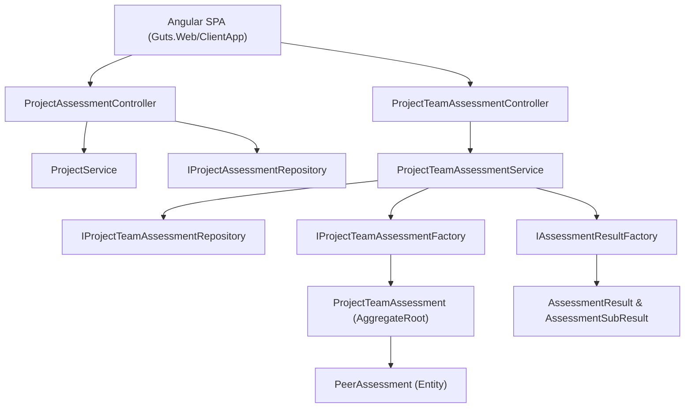

# Technical Design: Project Team Peer Assessments

- **Feature ID**: `001-peer-assessments`
- **Specification**: [`spec.md`](./spec.md)
- **Status**: `Implemented` (Baseline Reference Design)

---

## 1. Architectural Overview

The Peer Assessments feature spans three domain aggregates/value-object clusters (`ProjectAggregate`, `ProjectTeamAssessmentAggregate`, and `AssessmentResultAggregate`), orchestrated by `ProjectTeamAssessmentService` and `ProjectService`, persisted via EF Core repositories, and exposed through two REST controllers (`ProjectAssessmentController` and `ProjectTeamAssessmentController`) consumed by the Angular SPA.

---

## 2. Domain Layer (`Guts.Domain`)

### Aggregates, Entities & Value Objects

1. **`AssessmentScore` (`Guts.Domain/ValueObjects/AssessmentScore.cs`)**
   - Inherits from `ValueObject<AssessmentScore>`.
   - Static instances: `NullScore (-1)`, `NoAddedValue (0)`, `WayBelowAverage (1)`, `BelowAverage (2)`, `Average (3)`, `AboveAverage (4)`, `WayAboveAverage (5)`.
   - Implicit conversions between `int`, `double` (rounded via `MidpointRounding.AwayFromZero`), and `AssessmentScore`.

2. **`ProjectAssessment` (`Guts.Domain/TopicAggregate/ProjectAggregate/ProjectAssessment.cs`)**
   - Entity defining an assessment milestone for a `Project` (`ProjectId`, `Description`, `OpenOnUtc`, `DeadlineUtc`).
   - Created via `ProjectAssessment.Factory` (`IProjectAssessmentFactory`) and mutated via `Update(...)`.

3. **`ProjectTeamAssessment` (`Guts.Domain/ProjectTeamAssessmentAggregate/ProjectTeamAssessment.cs`)**
   - `AggregateRoot` linking an `IProjectAssessment` and an `IProjectTeam`.
   - Holds `HashSet<IPeerAssessment> _peerAssessments` exposed as `IReadOnlyCollection<IPeerAssessment> PeerAssessments`.
   - Computed property `IsComplete` checks `(int)Math.Pow(Team.TeamUsers.Count, 2) == _peerAssessments.Count`.
   - Key domain methods:
     - `AddOrUpdatePeerAssessment(userId, subjectId, cooperationScore, contributionScore, effortScore, explanation)`
     - `GetPeerAssessmentsOf(userId)`
     - `GetMissingPeerAssessmentsOf(userId)`
     - `GetPeersThatNeedToEvaluateOthers()`
     - `ValidateAssessmentsOf(userId)`

4. **`PeerAssessment` (`Guts.Domain/ProjectTeamAssessmentAggregate/PeerAssessment.cs`)**
   - `Entity` representing a single evaluation by `User` (evaluator) about `Subject` (teammate) within a `ProjectTeamAssessment`.
   - Computed property `IsSelfAssessment => User.Id == Subject.Id`.
   - Scores updated via `SetScores(...)`.

5. **`AssessmentResult` & `AssessmentSubResult` (`Guts.Domain/AssessmentResultAggregate/`)**
   - Transient domain read/calculation models constructed in-memory from a `ProjectTeamAssessment` via `AssessmentResult.Factory` (`IAssessmentResultFactory`) and `AssessmentSubResult.Factory` (`IAssessmentSubResultFactory`).
   - Computes `AverageResult` (mean of the 3 criteria), `EffortResult`, `ContributionResult`, and `CooperationResult`.

---

## 3. Business Layer (`Guts.Business`)

### Repository Contracts (`Guts.Business/Repositories/`)
- `IProjectAssessmentRepository`:
  - `Task<IReadOnlyList<IProjectAssessment>> FindByProjectIdAsync(int projectId);`
- `IProjectTeamAssessmentRepository`:
  - `Task<IProjectTeamAssessment> LoadAsync(int projectAssessmentId, int teamId);`

### Application Services (`Guts.Business/Services/`)
- **`IProjectTeamAssessmentService` / `ProjectTeamAssessmentService`** (`Guts.Business/Services/Assessment/`):
  - `GetOrCreateTeamAssessmentAsync(projectAssessmentId, projectTeamId)` — Loads existing `ProjectTeamAssessment` or provisions a new one via `IProjectTeamAssessmentFactory`.
  - `GetStatusAsync(projectAssessmentId, teamId)` — Returns `ProjectTeamAssessmentStatusDto`.
  - `GetResultsForLectorAsync(projectAssessmentId, teamId)` — Generates `IAssessmentResult` for all team members with `includePeerAssessments: true`.
  - `GetResultForStudent(projectAssessmentId, teamId, userId)` — Generates `IAssessmentResult` for the student with `includePeerAssessments: false`.
  - `GetPeerAssessmentsOfUserAsync(projectAssessmentId, teamId, userId)` — Concatenates stored and missing `IPeerAssessment` records for the user.
  - `SavePeerAssessmentsOfUserAsync(projectAssessmentId, teamId, userId, peerAssessments)` — Applies each `PeerAssessmentDto`, invokes `ValidateAssessmentsOf(userId)`, and persists via `repository.UpdateAsync(...)`.

### DTOs (`Guts.Business/Dtos/`)
- `ProjectTeamAssessmentStatusDto` (`Id`, `TeamId`, `IsComplete`, `PeersThatNeedToEvaluateOthers`)
- `PeerAssessmentDto` (`UserId`, `SubjectId`, `CooperationScore`, `ContributionScore`, `EffortScore`, `Explanation`)

---

## 4. Infrastructure Layer (`Guts.Infrastructure`)

### Repository Implementations (`Guts.Infrastructure/Repositories/`)
- `ProjectAssessmentDbRepository`: Queries `Set<ProjectAssessment>()` by `ProjectId`.
- `ProjectTeamAssessmentDbRepository`:
  - `LoadAsync(projectAssessmentId, teamId)` uses `.AsSplitQuery()` and eagerly loads:
    - `Team.TeamUsers` -> `ThenInclude(tu => tu.User)`
    - `ProjectAssessment`
    - `PeerAssessments` -> `ThenInclude(pa => pa.User)`

---

## 5. API Layer (`Guts.Api`)

### REST Endpoints (`Guts.Api/Controllers/`)

1. **`ProjectAssessmentController` (`/api/project-assessments`)**
   - `GET of-project/{projectId}` — List assessments for a project.
   - `GET {id}` — Get single project assessment.
   - `POST ""` (`LectorsOnlyPolicy`) — Create a project assessment.
   - `PUT {id}` (`LectorsOnlyPolicy`) — Update a project assessment.
   - `DELETE {id}` (`LectorsOnlyPolicy`) — Delete a project assessment.

2. **`ProjectTeamAssessmentController` (`/api/project-team-assessments`)**
   - `GET of-project-assessment/{projectAssessmentId}/of-team/{teamId}/status` — Get completion status and pending evaluators.
   - `GET of-project-assessment/{projectAssessmentId}/of-team/{teamId}/peer-assessments` — Get current user's stored + placeholder peer evaluations.
   - `POST of-project-assessment/{projectAssessmentId}/of-team/{teamId}/peer-assessments` — Save current user's peer evaluations.
   - `GET of-project-assessment/{projectAssessmentId}/of-team/{teamId}/detailed-results` (`LectorsOnlyPolicy`) — Get full team assessment results including individual peer evaluations.
   - `GET of-project-assessment/{projectAssessmentId}/of-team/{teamId}/my-result` — Get current student's summary result.

---

## 6. Frontend Layer (`Guts.Web/ClientApp`)

### Services & ViewModels
- `ProjectAssessmentService` (`src/app/services/project.assessment.service.ts`)
- `ProjectTeamAssessmentService` (`src/app/services/project.teamassessment.service.ts`)
- ViewModels in `src/app/viewmodels/projectassessment.model.ts`

### Components (`src/app/components/`)
- `project-assessment-overview`: Lists assessments for a project, shows team status, and links to evaluation/result views.
- `project-assessment-add` & `project-assessment-edit`: Lector forms for managing assessment windows.
- `project-team-assessment-evaluation-form` & `assessment-score-dropdown`: Student evaluation table for scoring self and peers.
- `project-team-assessment-my-result`: Student view comparing self-scores against peer averages.
- `project-team-assessment-detailed-results`: Lector view showing full team matrix and individual peer explanations.

