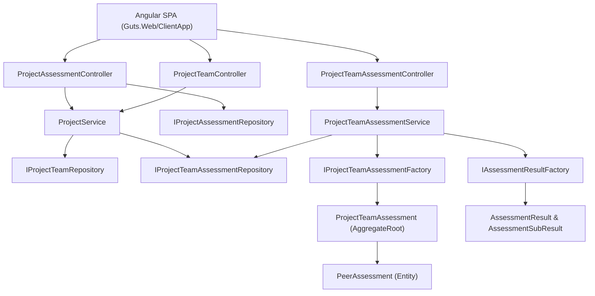

# Technical Design: Project Team Peer Assessments

- **Feature ID**: `001-peer-assessments`
- **Specification**: [`spec.md`](./spec.md)
- **Status**: `Implemented`

---

## 1. Architectural Overview

The Peer Assessments feature spans four domain aggregates/value-object clusters (`ProjectAggregate`, `ProjectTeamAggregate`, `ProjectTeamAssessmentAggregate`, and `AssessmentResultAggregate`), orchestrated by `ProjectTeamAssessmentService` and `ProjectService`, persisted via EF Core repositories, and exposed through two REST controllers (`ProjectAssessmentController` and `ProjectTeamAssessmentController`) plus `ProjectTeamController`, consumed by the Angular SPA.



---

## 2. Domain Layer (`Guts.Domain`)

### Aggregates, Entities & Value Objects

1. **`AssessmentScore` (`Guts.Domain/ValueObjects/AssessmentScore.cs`)**
   - Inherits from `ValueObject<AssessmentScore>`.
   - Static instances: `NullScore (-1)`, `NoAddedValue (0)`, `WayBelowAverage (1)`, `BelowAverage (2)`, `Average (3)`, `AboveAverage (4)`, `WayAboveAverage (5)`.
   - Implicit conversions between `int`, `double` (rounded via `MidpointRounding.AwayFromZero`), and `AssessmentScore`.

2. **`ProjectAssessment` (`Guts.Domain/TopicAggregate/ProjectAggregate/ProjectAssessment.cs`)**
   - Entity defining an assessment milestone for a `Project` (`ProjectId`, `Description`, `OpenOnUtc`, `DeadlineUtc`).
   - Created via `ProjectAssessment.Factory` (`IProjectAssessmentFactory`) and mutated via `Update(...)`.

3. **`ProjectTeamAssessment` & `IProjectTeamAssessment` (`Guts.Domain/ProjectTeamAssessmentAggregate/`)**
   - `AggregateRoot` linking an `IProjectAssessment` and an `IProjectTeam`.
   - Holds `HashSet<User> _peers` exposed as `IReadOnlyCollection<User> Peers` (`[DR-3]`, `[DR-4]`, `[AC-2]`) — initialized by copying `team.TeamUsers.Select(tu => tu.User)` in `ProjectTeamAssessment.Factory.CreateNew`.
   - Holds `HashSet<IPeerAssessment> _peerAssessments` exposed as `IReadOnlyCollection<IPeerAssessment> PeerAssessments`.
   - **`bool IsComplete`** (`[DR-5]`):
     - Returns `true` strictly when `_peers.Count >= 2 && _peerAssessments.Count == _peers.Count * _peers.Count`.
     - Requires at least 2 peers ($N \ge 2$); a 1-person assessment ($N < 2$) never evaluates to `IsComplete == true`.
   - **Domain Methods**:
     - `User GetPeer(int userId)` (`[DR-4]`, `[DR-8]`):
       - Returns the matching `User` from `_peers`, or throws `ContractException` (`"The user with id '{userId}' is not a peer in this team assessment."`).
     - `void AddPeer(int userId)` (`[AC-9]`, `[DR-4]`, `[DR-10]`):
       - Enforces `Contracts.Require(!IsComplete, "The team assessment is completed by all peers. It is not possible anymore to add or remove peers.");`.
       - Resolves `User user = Team.GetTeamUser(userId);` (throws `ContractException` if the user is not a current member of `Team.TeamUsers`).
       - If `_peers.All(p => p.Id != userId)`, adds `user` to `_peers`.
     - `IReadOnlyList<IPeerAssessment> RemovePeer(int userId)` (`[AC-8]`, `[AC-9]`, `[DR-4]`, `[DR-10]`):
       - Enforces `Contracts.Require(!IsComplete, "The team assessment is completed by all peers. It is not possible anymore to add or remove peers.");`.
       - Removes any `User` with `Id == userId` from `_peers`.
       - Removes all `IPeerAssessment` entries from `_peerAssessments` where `pa.User.Id == userId || pa.Subject.Id == userId` and returns the removed `IPeerAssessment` list.
     - `void SetPeerInclusion(int userId, bool isIncluded)` (`[AC-9]`, `[DR-4]`):
       - Enforces `Contracts.Require(!IsComplete, "The team assessment is completed by all peers. It is not possible anymore to add or remove peers.");`.
       - Enforces `Team.GetTeamUser(userId)` (user must be a current member of `Team.TeamUsers`).
       - If `isIncluded`: calls `AddPeer(userId)`.
       - If `!isIncluded`: calls `RemovePeer(userId)`.
     - `AddOrUpdatePeerAssessment(...)`, `GetPeerAssessmentsOf(userId)`, `GetMissingPeerAssessmentsOf(userId)`, `GetPeersThatNeedToEvaluateOthers()`, and `ValidateAssessmentsOf(userId)`:
       - Operate against `Peers` / `GetPeer(userId)` rather than `Team.TeamUsers`.

4. **`PeerAssessment` (`Guts.Domain/ProjectTeamAssessmentAggregate/PeerAssessment.cs`)**
   - `Entity` representing a single evaluation by `User` (evaluator) about `Subject` (teammate) within a `ProjectTeamAssessment`.

5. **`AssessmentResult` & `AssessmentSubResult` (`Guts.Domain/AssessmentResultAggregate/`)**
   - **`AssessmentResult.Factory.Create(int subjectId, IProjectTeamAssessment projectTeamAssessment, bool includePeerAssessments)`** (`[AC-6]`, `[DR-8]`):
     - When `includePeerAssessments == false` (Student requesting `/my-result`): requires `subjectId` to be a current member of `projectTeamAssessment.Team.TeamUsers` (`projectTeamAssessment.Team.GetTeamUser(subjectId)`) AND a peer in `projectTeamAssessment.Peers` (`projectTeamAssessment.GetPeer(subjectId)`), preventing removed team members from accessing team results.
     - When `includePeerAssessments == true` (Teacher requesting `/detailed-results`): resolves `User subject = projectTeamAssessment.GetPeer(subjectId)`, allowing results to be generated for all peers in `projectTeamAssessment.Peers` (including members later removed from `Team.TeamUsers`).

---

## 3. Business Layer (`Guts.Business`)

### Repository Contracts (`Guts.Business/Repositories/`)
- `IProjectAssessmentRepository`:
  - `Task<IReadOnlyList<IProjectAssessment>> FindByProjectIdAsync(int projectId);`
- `IProjectTeamAssessmentRepository`:
  - `Task<IProjectTeamAssessment> LoadAsync(int projectAssessmentId, int teamId);`

### Application Services (`Guts.Business/Services/`)
- **`IProjectTeamAssessmentService` / `ProjectTeamAssessmentService`** (`Guts.Business/Services/Assessment/`):
  - `GetOrCreateTeamAssessmentAsync(projectAssessmentId, projectTeamId)` — Loads existing `ProjectTeamAssessment` or provisions a new one via `IProjectTeamAssessmentFactory`.
  - `GetStatusAsync(projectAssessmentId, teamId)` — Returns `ProjectTeamAssessmentStatusDto` including `PeerIds` (`teamAssessment.Peers.Select(u => u.Id).ToList()`).
  - `GetResultsForTeacherAsync(projectAssessmentId, teamId)` (`[AC-6]`):
    - Iterates over `teamAssessment.Peers` (instead of `teamAssessment.Team.TeamUsers`) and invokes `assessmentResultFactory.Create(peer.Id, teamAssessment, true)`.
  - `GetResultForStudent(projectAssessmentId, teamId, userId)` — Invokes `assessmentResultFactory.Create(userId, teamAssessment, false)`.
  - `GetPeerAssessmentsOfUserAsync(projectAssessmentId, teamId, userId)` — Concatenates stored and missing `IPeerAssessment` records for the user.
  - `SavePeerAssessmentsOfUserAsync(projectAssessmentId, teamId, userId, peerAssessments)` — Applies each `PeerAssessmentDto`, invokes `ValidateAssessmentsOf(userId)`, and persists via `repository.UpdateAsync(...)`.
  - **New Method**: `Task SetPeerInclusionAsync(int projectAssessmentId, int teamId, int userId, bool isIncluded)` (`[AC-9]`):
    - Loads (or creates) the `ProjectTeamAssessment` via `GetOrCreateTeamAssessmentAsync(projectAssessmentId, teamId)`.
    - Calls `teamAssessment.SetPeerInclusion(userId, isIncluded)`.
    - Persists changes via `repository.UpdateAsync(teamAssessment)`.

### DTOs (`Guts.Business/Dtos/`)
- `ProjectTeamAssessmentStatusDto`:
  - `Id`, `TeamId`, `IsComplete`, `PeersThatNeedToEvaluateOthers`, and **new property** `IReadOnlyList<int> PeerIds { get; set; }`.
- `PeerAssessmentDto` (`UserId`, `SubjectId`, `CooperationScore`, `ContributionScore`, `EffortScore`, `Explanation`)

---

## 4. Infrastructure Layer (`Guts.Infrastructure`)

### EF Core Configuration & Migrations
- **`ProjectTeamAssessmentConfiguration` (`Guts.Infrastructure/EntityConfigurations/ProjectTeamAssessmentConfiguration.cs`)**:
  - Maps `ProjectTeamAssessment.Peers` (backed by `_peers`) as a many-to-many relationship to `User` using join table `ProjectTeamAssessmentPeers`:
    ```csharp
    builder.HasMany(pta => pta.Peers)
        .WithMany()
        .UsingEntity<Dictionary<string, object>>(
            "ProjectTeamAssessmentPeers",
            j => j.HasOne<User>().WithMany().HasForeignKey("UserId").OnDelete(DeleteBehavior.Cascade),
            j => j.HasOne<ProjectTeamAssessment>().WithMany().HasForeignKey("ProjectTeamAssessmentId").OnDelete(DeleteBehavior.Cascade));
    builder.Metadata.FindNavigation(nameof(ProjectTeamAssessment.Peers)).SetPropertyAccessMode(PropertyAccessMode.Field);
    ```
- **Migration Required?**: `Yes`
  - Migration creates the `ProjectTeamAssessmentPeers` join table (`ProjectTeamAssessmentId`, `UserId`) and executes a data migration SQL statement in `Up(...)` to populate `ProjectTeamAssessmentPeers` for all existing `ProjectTeamAssessments` (selecting distinct `(ProjectTeamAssessmentId, UserId)` pairs from the assessment's `ProjectTeamUsers` and stored `PeerAssessments`).

### Repository Implementations (`Guts.Infrastructure/Repositories/`)
- **`ProjectTeamAssessmentDbRepository`**:
  - `LoadAsync(projectAssessmentId, teamId)` eagerly loads:
    - `Team.TeamUsers` -> `ThenInclude(tu => tu.User)`
    - `ProjectAssessment`
    - `Peers`
    - `PeerAssessments` -> `ThenInclude(pa => pa.User)`
    - `PeerAssessments` -> `ThenInclude(pa => pa.Subject)`
  - `UpdateAsync(IProjectTeamAssessment existingEntity)`:
    - Ensures any `PeerAssessment` removed from `existingEntity.PeerAssessments` (e.g., when a Teacher excludes a peer via `SetPeerInclusion(userId, false)`) is deleted from `_context.PeerAssessments` before `SaveChangesAsync()`.
- **`ProjectTeamDbRepository`**:
  - `AddUserToTeam(int teamId, int userId)` (`[AC-9]`, `[DR-10]`):
    - Adds the `ProjectTeamUser` to `_context.ProjectTeamUsers` and saves (or loads the user into `Team.TeamUsers`).
    - Loads all `ProjectTeamAssessment` aggregates for `teamId` (including `Team.TeamUsers.User`, `ProjectAssessment`, `Peers`, and `PeerAssessments`).
    - For each `teamAssessment` where `!teamAssessment.IsComplete && DateTime.UtcNow <= teamAssessment.ProjectAssessment.DeadlineUtc`, invokes `teamAssessment.AddPeer(userId)`.
  - `RemoveUserFromTeam(int teamId, int userId)` (`[AC-8]`, `[DR-10]`):
    - Loads the `ProjectTeamUser` (throws `ContractException` if not found).
    - Loads all `ProjectTeamAssessment` aggregates for `teamId` (including `Team.TeamUsers.User`, `ProjectAssessment`, `Peers`, and `PeerAssessments` with `User` and `Subject`).
    - For each `teamAssessment` where `!teamAssessment.IsComplete`, invokes `teamAssessment.RemovePeer(userId)` and marks the returned `IPeerAssessment` records as `EntityState.Deleted`. Completed assessments (`teamAssessment.IsComplete == true`) are left untouched.
    - Marks the `ProjectTeamUser` as `EntityState.Deleted` and saves changes.

---

## 5. API Layer (`Guts.Api`)

### REST Endpoints (`Guts.Api/Controllers/`)

1. **`ProjectAssessmentController` (`/api/project-assessments`)**
   - Unchanged.

2. **`ProjectTeamAssessmentController` (`/api/project-team-assessments`)**
   - `GET of-project-assessment/{projectAssessmentId}/of-team/{teamId}/status` — Returns `ProjectTeamAssessmentStatusDto` (now including `PeerIds`).
   - `GET of-project-assessment/{projectAssessmentId}/of-team/{teamId}/peer-assessments` — Get current user's stored + placeholder peer evaluations.
   - `POST of-project-assessment/{projectAssessmentId}/of-team/{teamId}/peer-assessments` — Save current user's peer evaluations.
   - `GET of-project-assessment/{projectAssessmentId}/of-team/{teamId}/detailed-results` (`LectorsOnlyPolicy`) — Get full team assessment results including individual peer evaluations.
   - `GET of-project-assessment/{projectAssessmentId}/of-team/{teamId}/my-result` — Get current student's summary result.
   - **New Endpoint** (`[AC-9]`):
     - `PUT of-project-assessment/{projectAssessmentId}/of-team/{teamId}/peers/{userId}/inclusion` (`[Authorize(Policy = ApiConstants.LectorsOnlyPolicy)]`)
     - Request Body: `[FromBody] bool isIncluded`
     - Calls `projectTeamAssessmentService.SetPeerInclusionAsync(projectAssessmentId, teamId, userId, isIncluded)` and returns `200 OK`.

---

## 6. Frontend Layer (`Guts.Web/ClientApp`)

### Services & ViewModels
- **`projectassessment.model.ts`**:
  - Extend `IProjectTeamAssessmentStatusModel` and `ProjectTeamAssessmentStatusModel` with `peerIds: number[]`.
- **`ProjectTeamAssessmentService` (`src/app/services/project.teamassessment.service.ts`)**:
  - Add `setPeerInclusion(projectAssessmentId: number, teamId: number, userId: number, isIncluded: boolean): Observable<PostResult>` calling `PUT api/project-team-assessments/of-project-assessment/${projectAssessmentId}/of-team/${teamId}/peers/${userId}/inclusion`.

### Components (`src/app/components/`)
- **`ProjectTeamEditComponent` (`src/app/components/project-team-edit/`)** (`[AC-9]`):
  - Accepts `@Input() openAssessments: IProjectAssessmentModel[]` (or loads open assessments for the project) and fetches team assessment statuses (`getProjectTeamAssessmentStatus`).
  - Filters to incomplete assessments (`!status.isComplete`).
  - For each team member in `team.members`, renders an inclusion checkbox per incomplete open assessment allowing the Teacher to include or exclude that peer (`isPeerIncluded(assessment, member)` / `togglePeerInclusion(assessment, member, isIncluded)`).
  - Updates the removal confirmation prompt in `ProjectTeamEditComponent` and `ProjectTeamComponent` to clarify that only open/incomplete peer assessments are deleted when a member leaves or is removed.

---

## 7. Dependency Injection (`Guts.Bootstrapper`)

- All modified and existing Factories (`*Factory`), Services (`*Service`), Repositories (`*Repository`), and Converters (`*Converter`) follow the naming conventions in `StartUpExtensions.cs` and are automatically registered in the DI container.
