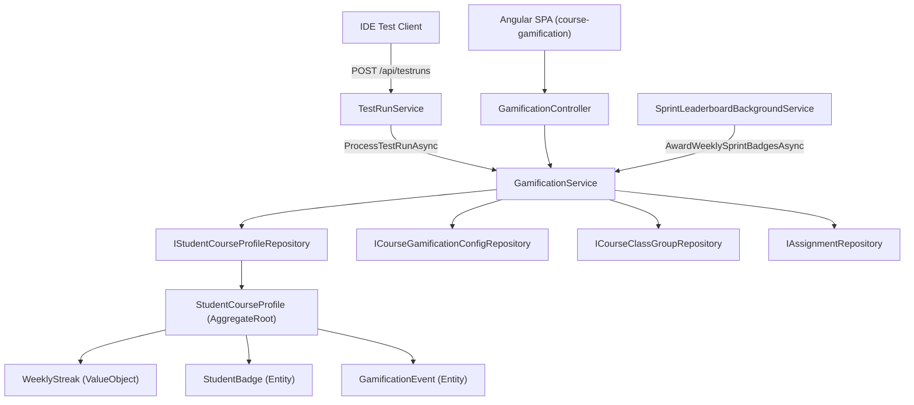

# Technical Design: Course Gamification

- **Feature ID**: `002-gamification`
- **Specification**: [`spec.md`](./spec.md)
- **Status**: `Implemented` (Baseline Reference Design)

---

## 1. Architectural Overview

The Course Gamification subsystem hooks into test-run registration (`TestRunService.RegisterRunAsync`), exposes a REST API (`GamificationController`) for the Angular dashboard, and runs a hosted background worker (`SprintLeaderboardBackgroundService`) to award weekly sprint medals and evaluate weekly streak expiration/protection.

---

## 2. Domain Layer (`Guts.Domain/GamificationAggregate/`)

### Aggregates, Entities, Value Objects & Enums

1. **`StudentCourseProfile` (`StudentCourseProfile.cs`)**
   - `AggregateRoot` scoped to `(UserId, CourseId, PeriodId)`.
   - Properties: `ShowInLeaderBoard`, `UsePseudonym`, `Pseudonym`, `Avatar`, `ClassGroupId`, `TotalXp`, `WeeklyStreak`, `LastLeaderboardVisitDate`, `Badges`, `Events`.
   - Computed properties: `Level` ($\lfloor\sqrt{\text{TotalXp}/25.0}\rfloor + 1$) and `LevelTitle`.
   - Domain methods:
     - `Enroll(showInLeaderBoard, pseudonym, avatar, classGroupId, usePseudonym)`
     - `HideFromLeaderboard()` / `ShowOnLeaderboard()`
     - `RecordLeaderboardVisit(visitDateTime)` — 10-minute cooldown before updating `LastLeaderboardVisitDate`.
     - `AwardPassedTestXp(testId, timestamp, isStreakEnabled, isBadgesEnabled)` — Awards `+10 XP`, updates `WeeklyStreak`, and checks `FirstSpark`, `CenturyClub`, `NightOwl`, `EarlyBird`, `WeekendWarrior`.
     - `AwardAssignmentBonus(assignmentId, timestamp, previousCompletionsCount, isBadgesEnabled)` — Awards `+50 XP` plus top-10 quick bonus (`+50 / +40 / +30 / +20 XP`) and `SpeedDemon` badge.
     - `AwardChapterBonus(chapterId, timestamp, isBadgesEnabled)` — Awards `+100 XP` and `CleanSweep` badge.
     - `AwardTeamSynergyBonus(componentId, timestamp, isBadgesEnabled)` — Awards `+30 XP` and `TeamPowerhouse` badge.
     - `AwardBadge(badgeType, timestamp)` — Idempotently adds a `StudentBadge`.
     - `RecordWeeklyActivity(timestamp)` — Updates `WeeklyStreak` and awards `OnFire` (4 weeks) / `IronWill` (8 weeks).
     - `NeedsWeeklyStreakEvaluation(timestamp)` — Fast in-memory check (`WeeklyStreak.NeedsEvaluation(timestamp)`) returning `true` only when `CurrentStreak > 0` and `weeksDiff > 1`.
     - `EvaluateWeeklyStreak(timestamp, allAvailableCourseTestIds)` — Short-circuits in memory if `!NeedsWeeklyStreakEvaluation(timestamp)`; otherwise checks whether all available course tests (`allAvailableCourseTestIds.Count > 0`) have been passed by the student (`GamificationEventType.PassedTest`), transitions `WeeklyStreak` via `WeeklyStreak.EvaluateStreak(timestamp, hasPassedAllAvailableTests)`, and returns `true` if `WeeklyStreak` changed.
   - Factory: `StudentCourseProfile.Factory` (`IStudentCourseProfileFactory`).

2. **`WeeklyStreak` (`WeeklyStreak.cs`)**
   - `ValueObject<WeeklyStreak>` tracking `CurrentStreak`, `BestStreak`, `LastActiveYear`, and `LastActiveWeek` using `System.Globalization.ISOWeek`.
   - Immutable transitions via:
     - `RecordActivity(DateTime timestamp)` — Increments or starts streak when XP is earned in a week.
     - `EvaluateStreak(DateTime timestamp, bool hasPassedAllAvailableTests)` — Evaluates streak expiration across ISO week boundaries (`weeksDiff > 1`): resets `CurrentStreak` to `0` (preserving `BestStreak`) if no XP was earned in the last week and not all available course tests are passed, or keeps `CurrentStreak` and advances `LastActiveYear`/`LastActiveWeek` to the preceding ISO week when `hasPassedAllAvailableTests == true`.
   - Query helpers:
     - `IsActiveInWeek(DateTime timestamp)`
     - `NeedsEvaluation(DateTime timestamp)` — Returns `true` only when `CurrentStreak > 0`, `LastActiveYear > 0`, and `CalculateWeeksDifference(LastActiveYear, LastActiveWeek, year, week) > 1`. Once evaluated, either `CurrentStreak` becomes `0` or `LastActiveWeek` becomes `week - 1` (`weeksDiff == 1`), ensuring `NeedsEvaluation` is `false` for the remainder of the week.

3. **`CourseGamificationConfig` (`CourseGamificationConfig.cs`)**
   - `AggregateRoot` storing course-level toggles: `IsGamificationEnabled` (default `false`), `IsWeeklyStreakEnabled`, `IsLeaderboardEnabled`, `IsClassCompetitionEnabled`, `IsTeamSynergyEnabled`, `IsBadgesEnabled` (all default `true`).

4. **`CourseClassGroup` (`CourseClassGroup.cs`)**
   - `AggregateRoot` representing a student class group (`Name`, `CourseId`, `PeriodId`).
   - Factory: `CourseClassGroup.Factory` (`ICourseClassGroupFactory`).

5. **`GamificationEvent` (`GamificationEvent.cs`) & `GamificationEventType` (`GamificationEventType.cs`)**
   - `Entity` recording an XP-earning event (`StudentCourseProfileId`, `EventType`, `TargetId`, `XpEarned`, `CreatedAt`).
   - Enum values: `PassedTest (1)`, `AssignmentCompleted (2)`, `ChapterCompleted (3)`, `TeamSynergy (4)`, `AssignmentCompletedQuickly (5)`.

6. **`StudentBadge` (`StudentBadge.cs`) & `BadgeType` (`BadgeType.cs`)**
   - `Entity` recording an unlocked achievement (`StudentCourseProfileId`, `BadgeType`, `EarnedAt`).
   - 15 badge types (`FirstSpark`, `SpeedDemon`, `CleanSweep`, `NightOwl`, `EarlyBird`, `WeekendWarrior`, `CenturyClub`, `OnFire`, `IronWill`, `SprintGold`, `TeamPowerhouse`, `SprintSilver`, `SprintBronze`, `SprintTop4`, `SprintTop5`).

---

## 3. Business Layer (`Guts.Business`)

### Repository Contracts (`Guts.Business/Repositories/`)
- `IStudentCourseProfileRepository`:
  - `GetByUserCourseAndPeriodAsync(int userId, int courseId, int periodId)`
  - `GetByCourseAndPeriodAsync(int courseId, int periodId)` — Retrieves all profiles for a `(courseId, periodId)` (for weekly background evaluation).
  - `GetForLeaderboardByCourseAndPeriodAsync(int courseId, int periodId)`
  - `CountAssignmentCompletionsAsync(int assignmentId, int courseId, int periodId)`
  - `UpdateRangeAsync(IEnumerable<StudentCourseProfile> entities)` — Batch-persists modified profiles in a single `SaveChangesAsync()` call.
- `ICourseGamificationConfigRepository`:
  - `GetByCourseIdAsync(int courseId)`
- `ICourseClassGroupRepository`:
  - `GetByCourseAndPeriodAsync(int courseId, int periodId)`
  - `GetByNameAsync(int courseId, int periodId, string name)`
- `IAssignmentRepository`:
  - `GetCourseTestIdsAsync(int courseId, int periodId)` — Lightweight `SELECT t.Id` projection returning `IReadOnlyList<int>` without materializing or tracking `Assignment`/`Test` entity graphs.

### Application Services (`Guts.Business/Services/`)
- **`IGamificationService` / `GamificationService`** (`GamificationService.cs`):
  - `ProcessTestRunAsync(TestRun testRun)` (invoked by `TestRunService.RegisterRunAsync`)
  - `GetStudentCourseProfileAsync(userId, courseId, periodId)`:
    - Performs an in-memory `profile.NeedsWeeklyStreakEvaluation(DateTime.UtcNow)` check first (`false` on 99.9% of requests -> zero extra SQL queries). Only when `true`, lazily fetches `GetCourseTestIdsAsync(courseId, periodId)` (if the student has any `PassedTest` events), evaluates `profile.EvaluateWeeklyStreak(...)`, and persists the single profile update.
    - Filters `profile.Events` where `CreatedAt > previousVisit` (or all events if never visited).
    - Groups all `GamificationEventType.PassedTest` events into a single `RecentXpEventDto` (`Description = count == 1 ? "Made 1 test green" : $"Made {count} tests green"`, `XpEarned = sum`, `CreatedAt = max`), while mapping bonus events (`AssignmentCompleted`, `AssignmentCompletedQuickly`, `ChapterCompleted`, `TeamSynergy`) individually, ordered by `CreatedAt` descending.
  - `EnrollStudentAsync(userId, courseId, enrollDto, periodId)`
  - `GetWeeklySprintLeaderboardAsync(courseId, currentUserId, periodId)` & `GetHallOfFameLeaderboardAsync(courseId, currentUserId, periodId)` — Strictly read-only leaderboard projections with zero extra queries or `N+1` writes.
  - `GetClassGroupLeaderboardAsync(courseId, periodId)`
  - `GetCourseConfigAsync(courseId)` & `UpdateCourseConfigAsync(courseId, configDto)`
  - `GetCourseClassGroupsAsync(courseId, periodId)`, `AddCourseClassGroupAsync(courseId, name, periodId)`, `DeleteCourseClassGroupAsync(courseId, classGroupId)`
  - `AwardWeeklySprintBadgesAsync(year, weekNumber, periodId)` — Awards top-5 sprint medals for the completed ISO week and evaluates weekly streak expiration/protection across all course profiles that have `NeedsWeeklyStreakEvaluation == true` (fetching `GetCourseTestIdsAsync` at most once per course only if a candidate profile has `PassedTest` events, and batch-saving modified profiles via `UpdateRangeAsync`).
  - `GetBadgeMetadata()`

### DTOs (`Guts.Business/Dtos/Gamification/GamificationDtos.cs`)
- `StudentGamificationProfileDto`, `EnrollStudentDto`, `StudentBadgeDto`, `BadgeMetadataDto`, `RecentXpGainDto`, `RecentXpEventDto`, `LeaderboardEntryDto`, `ClassGroupLeaderboardEntryDto`, `CourseGamificationConfigDto`, `CourseClassGroupDto`.

---

## 4. Infrastructure Layer (`Guts.Infrastructure`)

### Repository Implementations (`Guts.Infrastructure/Repositories/`)
- `StudentCourseProfileDbRepository`:
  - Uses `.AsSplitQuery()` with `.Include(sp => sp.Badges)`, `.Include(sp => sp.Events)`, `.Include(sp => sp.ClassGroup)`, and `.Include(sp => sp.User)`.
  - `GetByCourseAndPeriodAsync` loads all profiles for `(CourseId, PeriodId)`, while `GetForLeaderboardByCourseAndPeriodAsync` additionally filters by `sp.ShowInLeaderBoard`.
  - `UpdateRangeAsync` updates modified profiles in a single `_context.SaveChangesAsync()` call.
  - `CountAssignmentCompletionsAsync` counts `GamificationEvents` with `EventType == GamificationEventType.AssignmentCompleted`.
- `CourseGamificationConfigDbRepository`: Queries `CourseGamificationConfigs` by `CourseId`.
- `CourseClassGroupDbRepository`: Queries `CourseClassGroups` by `(CourseId, PeriodId)` and case-insensitive/trimmed `Name`.
- `AssignmentDbRepository`: `GetCourseTestIdsAsync(courseId, periodId)` executes `_context.Tests.Where(t => t.Assignment.Topic.CourseId == courseId && t.Assignment.Topic.PeriodId == periodId).Select(t => t.Id).ToListAsync()`.

---

## 5. API & Background Services Layer (`Guts.Api`)

### REST Endpoints (`Guts.Api/Controllers/GamificationController.cs`)
Base route: `api/courses/{courseId}/gamification` (`[Authorize]`)
- `GET profile` — Get current student's profile & recent XP gains (`?periodId=`).
- `POST enroll` — Update student leaderboard opt-in, pseudonym, avatar, and class group (`?periodId=`).
- `GET leaderboard/weekly` — Weekly Sprint leaderboard (`?periodId=`).
- `GET leaderboard/hall-of-fame` — Hall of Fame leaderboard (`?periodId=`).
- `GET leaderboard/classes` — Class Championship leaderboard (`?periodId=`).
- `GET config` — Get course gamification config.
- `PUT config` (`[Authorize(Roles = Role.Constants.Lector)]`) — Update course gamification config.
- `GET classes` — List class groups for the course (`?periodId=`).
- `POST classes` (`[Authorize(Roles = Role.Constants.Lector)]`) — Add a class group (`?periodId=`).
- `DELETE classes/{classGroupId}` (`[Authorize(Roles = Role.Constants.Lector)]`) — Delete a class group.
- `GET badges` & `GET /api/gamification/badges` — Get static metadata (name, description, icon) for all badge types.

### Background Service (`Guts.Api/BackgroundServices/SprintLeaderboardBackgroundService.cs`)
- Hosted `BackgroundService` that schedules itself for every Monday at `00:01 UTC` (`GetNextMondayMorningTrigger`) and invokes `IGamificationService.AwardWeeklySprintBadgesAsync` for the preceding ISO week using a Friday `23:59:59 UTC` cutoff.

---

## 6. Frontend Layer (`Guts.Web/ClientApp`)

### Services & ViewModels
- `GamificationService` (`src/app/services/gamification.service.ts`)
- ViewModels in `src/app/viewmodels/gamification.model.ts`

### Components (`src/app/components/course-gamification/`)
- `course-gamification`: Parent container tabbing/orchestrating the course gamification experience.
- `course-gamification-hero`: Displays student level, title, XP progress bar, weekly streak, recent XP gains, and profile/privacy settings modal (`Enroll`).
- `course-gamification-sprint`: Weekly Sprint Leaderboard view.
- `course-gamification-hall-of-fame`: All-time Hall of Fame Leaderboard view.
- `course-gamification-class-championship`: Class Group competition view.
- `course-gamification-badges`: Badge showcase grid (earned vs. locked badges).
- `course-gamification-admin`: Lector administration panel for feature toggles and class group management.
