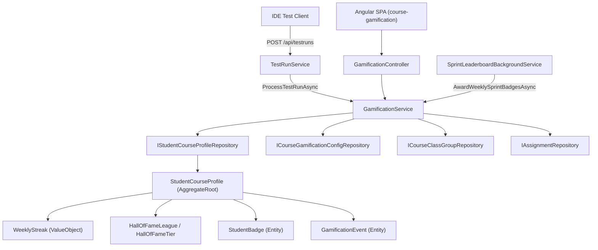

# Technical Design: Course Gamification

- **Feature ID**: `002-gamification`
- **Specification**: [`spec.md`](./spec.md)
- **Status**: `Implemented`

---

## 1. Architectural Overview

The Course Gamification subsystem hooks into test-run registration (`TestRunService.RegisterRunAsync`), exposes a REST API (`GamificationController`) for the Angular dashboard, and runs a hosted background worker (`SprintLeaderboardBackgroundService`) to award weekly sprint medals and evaluate weekly streak expiration/protection.



---

## 2. Domain Layer (`Guts.Domain/GamificationAggregate/`)

### Aggregates, Entities, Value Objects & Enums

1. **`HallOfFameTier` (`HallOfFameTier.cs`) & `HallOfFameLeague` (`HallOfFameLeague.cs`)**
   - `HallOfFameTier` enum (ordered from lowest `1` to highest `8` so `newTier > previousTier` indicates promotion):
     - `Paper = 1` (Rank `201+`, Icon `"📜"`)
     - `Wood = 2` (Rank `151–200`, Icon `"🪵"`)
     - `Iron = 3` (Rank `101–150`, Icon `"⚒️"`)
     - `Bronze = 4` (Rank `76–100`, Icon `"🛡️"`)
     - `Silver = 5` (Rank `56–75`, Icon `"⚔️"`)
     - `Gold = 6` (Rank `36–55`, Icon `"👑"`)
     - `Diamond = 7` (Rank `16–35`, Icon `"💎"`)
     - `Obsidian = 8` (Rank `1–15`, Icon `"🌋"`)
   - `HallOfFameLeague` static domain helper encapsulating `[DR-7]`:
     - `HallOfFameTier GetTierForRank(int rank)`:
       - Enforces `Contracts.Require(rank > 0, "Rank must be positive.")`.
       - Maps 1-based rank intervals: `1..15` ➔ `Obsidian`, `16..35` ➔ `Diamond`, `36..55` ➔ `Gold`, `56..75` ➔ `Silver`, `76..100` ➔ `Bronze`, `101..150` ➔ `Iron`, `151..200` ➔ `Wood`, `>= 201` ➔ `Paper`.
     - `(HallOfFameTier Tier, string Name, int MinRank, int? MaxRank, string Icon) GetTierMetadata(HallOfFameTier tier)`: returns display metadata for a tier.
     - `IReadOnlyList<HallOfFameTier> GetAllTiersDescending()`: returns `[Obsidian, Diamond, Gold, Silver, Bronze, Iron, Wood, Paper]`.
     - `IReadOnlyList<HallOfFameTier> GetVisibleTierWindow(HallOfFameTier currentTier)`:
       - Returns the 4-tier progression window `[Previous, Current, Next1, Next2]` (ordered from lowest to highest tier in the 4-tier slice, or clamped to 4 tiers at the boundaries):
         - When `currentTier == Paper (1)`: `[Paper, Wood, Iron, Bronze]` (`1, 2, 3, 4`).
         - When `currentTier >= Diamond (7)`: `[Silver, Gold, Diamond, Obsidian]` (`5, 6, 7, 8`).
         - Otherwise (`Wood` through `Gold`): `[currentTier - 1, currentTier, currentTier + 1, currentTier + 2]`.

2. **`StudentCourseProfile` (`StudentCourseProfile.cs`)**
   - `AggregateRoot` scoped to `(UserId, CourseId, PeriodId)`.
   - Persisted properties:
     - Existing: `ShowInLeaderBoard`, `UsePseudonym`, `Pseudonym`, `Avatar`, `ClassGroupId`, `TotalXp`, `WeeklyStreak`, `LastLeaderboardVisitDate`, `Badges`, `Events`.
     - New (`[DR-8]`):
       - `public int? BestHallOfFameRank { get; private set; }`
       - `public HallOfFameTier? BestHallOfFameTier { get; private set; }`
   - Computed properties:
     - `Level` ($\lfloor\sqrt{\text{TotalXp}/25.0}\rfloor + 1$) and `LevelTitle`.
     - `public DateTime LastXpEarnedAt`: returns the maximum `CreatedAt` timestamp among `Events.Where(e => e.XpEarned > 0)`, or `DateTime.MaxValue` if none exist (`[DR-7]` tie-breaking: the student who reached their `TotalXp` earlier has a smaller `LastXpEarnedAt` and ranks higher).
   - Domain methods:
     - `Enroll`, `HideFromLeaderboard`, `ShowOnLeaderboard`, `RecordLeaderboardVisit`
     - `AwardPassedTestXp`, `AwardAssignmentBonus`, `AwardChapterBonus`, `AwardTeamSynergyBonus`, `AwardBadge`, `RecordWeeklyActivity`, `NeedsWeeklyStreakEvaluation`, `EvaluateWeeklyStreak`
     - **New**: `public bool EvaluateHallOfFameProgression(int previousRank, int newRank, DateTime timestamp)` (`[AC-2]`, `[DR-8]`):
       - Enforces `Contracts.Require(previousRank > 0, "Previous rank must be positive.")` and `Contracts.Require(newRank > 0, "New rank must be positive.")`.
       - Computes effective prior best rank: `int effectiveBestRank = BestHallOfFameRank.HasValue ? Math.Min(BestHallOfFameRank.Value, previousRank) : previousRank;`
       - Computes effective prior best tier:
         ```csharp
         HallOfFameTier previousTier = HallOfFameLeague.GetTierForRank(previousRank);
         HallOfFameTier effectiveBestTier = BestHallOfFameTier.HasValue
             ? (HallOfFameTier)Math.Max((int)BestHallOfFameTier.Value, (int)previousTier)
             : previousTier;
         ```
       - If `newRank < previousRank && newRank < effectiveBestRank`:
         - For each newly surpassed rank `r` from `effectiveBestRank - 1` down to `newRank`:
           - If no `GamificationEvent` with `(HallOfFameOvertake, r)` exists yet, adds `new GamificationEvent(Id, GamificationEventType.HallOfFameOvertake, r, 4, timestamp)` and increments `TotalXp += 4`.
       - Computes `HallOfFameTier newTier = HallOfFameLeague.GetTierForRank(newRank)`.
       - If `(int)newTier > (int)effectiveBestTier`:
         - For each newly reached tier value `t` from `(int)effectiveBestTier + 1` to `(int)newTier`:
           - If no `GamificationEvent` with `(HallOfFameTierUp, t)` exists yet, adds `new GamificationEvent(Id, GamificationEventType.HallOfFameTierUp, t, 5, timestamp)` and increments `TotalXp += 5`.
       - Updates `BestHallOfFameRank = Math.Min(effectiveBestRank, newRank)` and `BestHallOfFameTier = (HallOfFameTier)Math.Max((int)effectiveBestTier, (int)newTier)`.
       - Returns `true` if `BestHallOfFameRank`, `BestHallOfFameTier`, or `TotalXp` changed.

3. **`GamificationEvent` (`GamificationEvent.cs`) & `GamificationEventType` (`GamificationEventType.cs`)**
   - Enum values:
     - `PassedTest = 1`
     - `AssignmentCompleted = 2`
     - `ChapterCompleted = 3`
     - `TeamSynergy = 4`
     - `AssignmentCompletedQuickly = 5`
     - `HallOfFameOvertake = 6` (`TargetId = surpassedRank`, `XpEarned = 4`)
     - `HallOfFameTierUp = 7` (`TargetId = (int)reachedTier`, `XpEarned = 5`)

---

## 3. Business Layer (`Guts.Business`)

### Repository Contracts (`Guts.Business/Repositories/`)
- `IStudentCourseProfileRepository`:
  - Existing methods: `GetByUserCourseAndPeriodAsync`, `GetByCourseAndPeriodAsync`, `GetForLeaderboardByCourseAndPeriodAsync`, `CountAssignmentCompletionsAsync`, `UpdateRangeAsync`.
  - **New method**:
    - `Task<bool> IsUserLectorAsync(int userId);` — Returns `true` if the user has the `Lector` role (`[DR-9]`).

### Application Services (`Guts.Business/Services/`)
- **`IGamificationService` / `GamificationService`** (`GamificationService.cs`):
  - `GetStudentCourseProfileAsync(int userId, int courseId, int? periodId = null, bool isLector = false, int? perspectiveUserId = null)`:
    - Resolves target user: `int targetUserId = isLector && perspectiveUserId.HasValue ? perspectiveUserId.Value : userId;`
    - Loads or creates the profile for `targetUserId` in `(courseId, period.Id)`.
    - Evaluates weekly streak expiration if needed.
    - If `isLector && perspectiveUserId.HasValue`, does **not** call `profile.RecordLeaderboardVisit()` so teacher inspection does not overwrite `LastLeaderboardVisitDate` or clear the student's recent gains banner.
    - Returns `StudentGamificationProfileDto` including level, streak, XP, and `EarnedBadges`.
  - `ProcessTestRunAsync(TestRun testRun)`:
    1. Short-circuits immediately if `await studentCourseProfileRepository.IsUserLectorAsync(testRun.UserId)` is `true` (`[AC-2]`, `[DR-9]`).
    2. Captures `int xpBefore = profile.TotalXp;` and `DateTime lastXpBefore = profile.LastXpEarnedAt;` prior to awarding test, assignment, chapter, and team synergy XP.
    3. If `config.IsLeaderboardEnabled && profile.ShowInLeaderBoard && profile.TotalXp > xpBefore`:
       - Loads `optedInProfiles = await studentCourseProfileRepository.GetForLeaderboardByCourseAndPeriodAsync(courseId, periodId)`.
       - Computes the student's `previousRank` (ranked using `(xpBefore, lastXpBefore)` against the other opted-in profiles) and `newRank` (ranked using `(profile.TotalXp, profile.LastXpEarnedAt)` against the other opted-in profiles) using the `[DR-7]` ordering (`TotalXp` descending, `LastXpEarnedAt` ascending, `Id` ascending).
       - Invokes `profile.EvaluateHallOfFameProgression(previousRank, newRank, testRun.CreateDateTime)`.
    4. Persists `profile` via `studentCourseProfileRepository.UpdateAsync(profile)`.
  - `BuildRecentEventDtos(IReadOnlyList<GamificationEvent> recentEvents)` (`[AC-5]`):
    - Aggregates `PassedTest` events into `"Made {count} test(s) green"`.
    - Aggregates `HallOfFameOvertake` events in the window into a single `RecentXpEventDto` (`Description = count == 1 ? "Overtake bonus (surpassed 1 student in Hall of Fame)" : $"Overtake bonus (surpassed {count} students in Hall of Fame)"`, `XpEarned = sum`, `CreatedAt = max`).
    - Maps each `HallOfFameTierUp` event to `"Hall of Fame level up bonus ({tierMetadata.Name})"`.
  - `GetWeeklySprintLeaderboardAsync(int courseId, int currentUserId, int? periodId = null)`:
    - Highlights `IsCurrentUser = item.Profile.UserId == currentUserId` (where `currentUserId` is the authenticated student or the Lector's `perspectiveUserId`).
  - `GetHallOfFameLeaderboardAsync(int courseId, int currentUserId, int? periodId = null, bool isLector = false, int? perspectiveUserId = null, HallOfFameTier? selectedTier = null)`:
    - Returns `HallOfFameLeaderboardDto`:
      - Orders opted-in student profiles by `TotalXp` descending, then `LastXpEarnedAt` ascending, then `Id` ascending (`[DR-7]`).
      - Determines global rank and assigns each student to their `HallOfFameTier` (`HallOfFameLeague.GetTierForRank(globalRank)`).
      - Assigns 1-based tier-relative `Rank` (`tierRank` starting at `1` for every tier) to each entry so global rank is never exposed in the UI.
      - **When viewing from a Student's perspective (`!isLector || perspectiveUserId.HasValue`)**:
        - Determines `targetUserId = isLector && perspectiveUserId.HasValue ? perspectiveUserId.Value : currentUserId`.
        - Finds the target student's entry and index in the full ordered list.
        - Determines `activeTier = targetStudentEntry?.Tier ?? HallOfFameTier.Paper`.
        - Sets `CurrentUserRank = targetStudentEntry?.Rank` (tier-relative rank).
        - Filters `Entries` to only those in `activeTier` (starting at rank 1 with 🥇, 🥈, 🥉).
        - Populates `VisibleTiers` using `HallOfFameLeague.GetVisibleTierWindow(activeTier)` with `IsCurrentTier = (tier == activeTier)`.
        - If `targetIndex > 0`, populates `NextTargetStudent` from the immediately preceding entry in course order (`allEntries[targetIndex - 1]`), carrying their tier-relative `Rank`, `TierName`, and `TierIcon`, with `XpNeededToOvertake = (aboveEntry.Score - targetStudentEntry.Score) + 1`.
      - **When viewing in Teacher All-Levels Mode (`isLector && !perspectiveUserId.HasValue`)**:
        - Populates `AllTiers` with metadata and student counts for all 8 tiers (`Obsidian` down to `Paper`).
        - If `selectedTier.HasValue`, filters `Entries` to `selectedTier.Value` and sets `CurrentTier` and `VisibleTiers` around `selectedTier.Value`; if `selectedTier == null`, returns all ranked entries across all tiers (each with their tier-relative rank starting at 1) and defaults `CurrentTier` to `Obsidian`.
        - Always populates `StudentOptions` (for `isLector == true`) with the list of ranked students displaying their tier-relative rank (`#{{ student.rank }} {{ student.displayName }} ({{ student.tierIcon }} {{ student.tierName }} — {{ student.score }} XP)`), completely avoiding global ranks.

### DTOs (`Guts.Business/Dtos/Gamification/GamificationDtos.cs`)
- Updated `LeaderboardEntryDto`:
  - Adds `HallOfFameTier Tier { get; set; }`, `string TierName { get; set; }`, and `string TierIcon { get; set; }`.
- New DTOs:
  - `HallOfFameTierDto`: `HallOfFameTier Tier`, `int TierId => (int)Tier`, `string Name`, `string Icon`, `int MinRank`, `int? MaxRank`, `bool IsCurrentTier`, `int StudentCount`.
  - `HallOfFameTargetStudentDto`: `int UserId`, `string DisplayName`, `string Avatar`, `int Rank`, `int Score`, `int XpNeededToOvertake`, `string TierName`, `string TierIcon`.
  - `HallOfFameStudentOptionDto`: `int UserId`, `string DisplayName`, `int Rank`, `int Score`, `string TierName`, `string TierIcon`.
  - `HallOfFameLeaderboardDto`:
    - `HallOfFameTierDto CurrentTier`
    - `IReadOnlyList<HallOfFameTierDto> VisibleTiers`
    - `IReadOnlyList<HallOfFameTierDto> AllTiers`
    - `HallOfFameTargetStudentDto NextTargetStudent`
    - `int? CurrentUserRank`
    - `IReadOnlyList<LeaderboardEntryDto> Entries`
    - `IReadOnlyList<HallOfFameStudentOptionDto> StudentOptions`

---

## 4. Infrastructure Layer (`Guts.Infrastructure`)

### EF Core Configuration & Migrations
- **`StudentCourseProfileConfiguration` (`Guts.Infrastructure/EntityConfigurations/StudentCourseProfileConfiguration.cs`)**:
  - Map `BestHallOfFameRank` (`IsRequired(false)`) and `BestHallOfFameTier` (`IsRequired(false)`).
- **Migration Required?**: `Yes`
  - Migration name: `AddHallOfFameTiersAndBestRank` (adds nullable `BestHallOfFameRank` and `BestHallOfFameTier` integer columns to `StudentCourseProfiles`).

### Repository Implementations (`Guts.Infrastructure/Repositories/StudentCourseProfileDbRepository.cs`)
- `IsUserLectorAsync(int userId)`:
  ```csharp
  return await (from ur in _context.UserRoles
                join r in _context.Roles on ur.RoleId equals r.Id
                where ur.UserId == userId && r.Name == Role.Constants.Lector
                select ur.UserId).AnyAsync();
  ```
- Exclude Lector accounts from `GetByCourseAndPeriodAsync`, `GetForLeaderboardByCourseAndPeriodAsync`, and `CountAssignmentCompletionsAsync` using a subquery on `_context.UserRoles` joined with `_context.Roles` where `r.Name == Role.Constants.Lector`.

---

## 5. API Layer (`Guts.Api`)

### REST Endpoints (`Guts.Api/Controllers/GamificationController.cs`)
- `GET api/courses/{courseId}/gamification/profile`:
  - Accepts `[FromQuery] int? periodId = null, [FromQuery] int? perspectiveUserId = null`.
  - Invokes `gamificationService.GetStudentCourseProfileAsync(GetUserId(), courseId, periodId, IsLector(), IsLector() ? perspectiveUserId : null)`.
  - Returns `StudentGamificationProfileDto`.
- `GET api/courses/{courseId}/gamification/leaderboard/weekly`:
  - Accepts `[FromQuery] int? periodId = null, [FromQuery] int? perspectiveUserId = null`.
  - Resolves `int effectiveUserId = IsLector() && perspectiveUserId.HasValue ? perspectiveUserId.Value : GetUserId();`
  - Invokes `gamificationService.GetWeeklySprintLeaderboardAsync(courseId, effectiveUserId, periodId)`.
- `GET api/courses/{courseId}/gamification/leaderboard/hall-of-fame`:
  - Accepts `[FromQuery] int? periodId = null, [FromQuery] int? perspectiveUserId = null, [FromQuery] HallOfFameTier? tier = null`.
  - Invokes `gamificationService.GetHallOfFameLeaderboardAsync(courseId, GetUserId(), periodId, IsLector(), IsLector() ? perspectiveUserId : null, IsLector() ? tier : null)`.
  - Produces `HallOfFameLeaderboardDto`.

---

## 6. Frontend Layer (`Guts.Web/ClientApp`)

### Services & ViewModels (`src/app/services/gamification.service.ts`, `src/app/viewmodels/gamification.model.ts`)
- `gamification.model.ts`:
  - Add `HallOfFameTier` enum and interfaces `IHallOfFameTierModel`, `IHallOfFameTargetStudentModel`, `IHallOfFameStudentOptionModel`, `IHallOfFameLeaderboardModel`.
- `gamification.service.ts`:
  - `getProfile(courseId: number, periodId?: number, perspectiveUserId?: number): Observable<GetResult<IStudentGamificationProfileModel>>`
  - `getWeeklySprint(courseId: number, periodId?: number, perspectiveUserId?: number): Observable<GetResult<ILeaderboardEntryModel[]>>`
  - `getHallOfFame(courseId: number, periodId?: number, perspectiveUserId?: number, tier?: number): Observable<GetResult<IHallOfFameLeaderboardModel>>`

### Components (`src/app/components/course-gamification/`)
1. **`CourseGamificationComponent` (`course-gamification.component.ts` & `.html`)**:
   - **Teacher Overview vs. Student Perspective**:
     - When `!userProfile.isTeacher()`, loads student profile via `getProfile(courseId, periodId)` and renders `<app-course-gamification-hero>` (editable mode).
     - When `userProfile.isTeacher()`:
       - Default ("All Levels", `perspectiveUserId = null`): `profile` is `null`, hero card is hidden, and Badges tab shows badge catalogue with 0 earned badges.
       - Selected student (`perspectiveUserId != null`): loads that student's profile via `getProfile(courseId, periodId, perspectiveUserId)` and renders `<app-course-gamification-hero [profile]="profile" [readOnly]="true">`, updates Badges tab badge counter `Badges ({{ profile?.earnedBadges?.length || 0 }})`, and passes `[profile]="profile"` to `<app-course-gamification-badges>`.
   - **Teacher Student Perspective Selector**:
     - When `userProfile.isTeacher()`, renders a selector bar at the top of the Gamification page allowing the teacher to pick between `"All Levels (Teacher Overview)"` (`perspectiveUserId = null`) or any student from `studentOptions` (`perspectiveUserId = student.userId`).
     - Passes `[perspectiveUserId]="perspectiveUserId"` and `[isTeacher]="userProfile.isTeacher()"` to `<app-course-gamification-hall-of-fame>` and `<app-course-gamification-sprint>`.
2. **`CourseGamificationHallOfFameComponent` (`course-gamification-hall-of-fame.component.ts`, `.html`, `.scss`)**:
   - Inputs: `courseId`, `periodId`, `isTeacher`, `perspectiveUserId`.
   - Output: `studentOptionsLoaded` (emits `IHallOfFameStudentOptionModel[]` to parent so the teacher student selector is populated).
   - **4-Icon Tier Progression Bar**:
     - Displays the 4 `visibleTiers` icons (`🌋`, `💎`, `👑`, `⚔️`, `🛡️`, `⚒️`, `🪵`, `📜`).
     - Active tier (`tier.isCurrentTier`) is rendered larger (`hall-of-fame-tier-current`: enlarged icon, bold title, rank range badge, no blur).
     - The other 3 tiers (`!tier.isCurrentTier`) are rendered smaller and slightly blurred (`hall-of-fame-tier-neighbor`: `filter: blur(1.2px); opacity: 0.65; transform: scale(0.9)`).
   - **Overtake Motivation Banner (`nextTargetStudent`)**:
     - Displays a motivational callout above the table when viewing from a student's perspective:
       - If `nextTargetStudent` exists: *"🎯 **Target to Overtake:** Earn **{{ nextTargetStudent.xpNeededToOvertake }} XP** to surpass **{{ nextTargetStudent.displayName }}** (#{{ nextTargetStudent.rank }}) and earn **+4 bonus XP**!"*
       - If `currentUserRank === 1`: *"🌋 **Apex Champion!** You hold Rank #1 in the Obsidian League!"*
   - **Teacher All-Levels Switcher**:
     - When `isTeacher && !perspectiveUserId`, renders tier filter pills for all 8 tiers (`allTiers`) plus an `"All Levels"` button so the teacher can inspect any individual tier or view all tiers at once.
3. **`CourseGamificationSprintComponent` (`course-gamification-sprint.component.ts` & `.html`)**:
   - Accepts `@Input() public isTeacher: boolean = false;` and `@Input() public perspectiveUserId?: number | null;` and passes `perspectiveUserId` to `gamificationService.getWeeklySprint(courseId, periodId, perspectiveUserId)` so the selected student is highlighted (`isCurrentUser`) when a teacher views the Weekly Sprint from a student's perspective.
   - Displays a motivational callout banner (`#weeklySprintGetOnBoardCallout`) when viewing from a student's perspective (`!isTeacher || !!perspectiveUserId`) and the student is not yet on the Weekly Sprint Leaderboard (`!isCurrentUserOnBoard`), triggering the student to earn XP to get on the board.
4. **`CourseGamificationHeroComponent` (`course-gamification-hero.component.ts` & `.html`)**:
   - Accepts `@Input() public readOnly: boolean = false;`.
   - When `readOnly` is `true`, the "Customize Profile" / settings button is hidden and `openSettings()` is disabled so teachers cannot alter a student's profile settings.

---

## 7. Dependency Injection (`Guts.Bootstrapper`)

- No new DI registrations required: `StudentCourseProfile.Factory`, `GamificationService`, and `StudentCourseProfileDbRepository` already follow the naming conventions in `StartUpExtensions.cs`.
