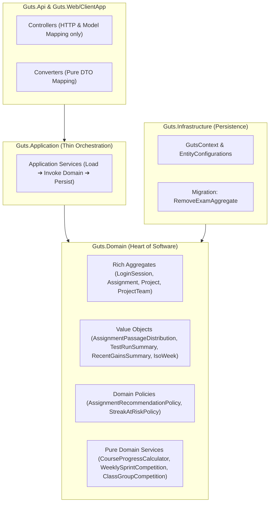

# Technical Design: DDD Domain Deep Modeling & Deprecated Exam Removal

- **Feature ID**: `003-ddd-refactoring`
- **Specification**: [`spec.md`](./spec.md)
- **Status**: `Implemented`

---

## 1. Architectural Overview

This refactoring implements Eric Evans' *Domain-Driven Design* (Part III: *Refactoring Toward Deeper Insight*) across the GUTS Backoffice. Business logic, calculations, and invariants that previously leaked into `Guts.Application` (formerly `Guts.Business`) and `Guts.Api` have been relocated to intention-revealing Domain Aggregates, Value Objects, Domain Policies, and pure Domain Services in `Guts.Domain`.

In addition, the deprecated `Exam` aggregate and all its dependencies have been purged across all layers.

---

## 2. Domain Layer (`Guts.Domain`)

### 2.1 Course Progress Domain Service (`Guts.Domain.CourseAggregate`)
- **`ICourseProgressCalculator` / `CourseProgressCalculator`**:
  - Pure, stateless domain service with zero repository or I/O dependencies.
  - Method: `CourseProgressReport CalculateProgress(Course course, IReadOnlyList<Chapter> chapters, IReadOnlyList<TestResult> latestTestResults)`.
  - Calculates per-student test pass counts, chapter completion, and overall course progress percentage.
- **Supporting Models**:
  - `CourseProgressReport`: Top-level report encapsulating course metadata and student summaries.
  - `CourseStudentProgress`: Student progress with `init` properties complying with Sonar RSPEC-107 parameter limits.
  - `CourseChapterProgress`: Chapter-level progress with assignment lists.
  - `CourseAssignmentProgress`: Assignment-level test pass counts.

### 2.2 Assignment Statistics & Recommendation (`Guts.Domain.AssignmentAggregate`)
- **`AssignmentPassageDistribution` (Value Object)**:
  - Groups test results by user or team, calculates test pass counts, and produces `TestPassageCount` distribution buckets.
- **`AssignmentRecommendationPolicy` & `RecommendedAssignment` (Domain Policy)**:
  - Evaluates student progress across a course's assignments.
  - Prioritizes in-progress assignments (progress $\in (0\%, 100\%)$) descending by progress percentage, falling back to earliest unattempted assignments.
- **`Assignment` Aggregate Root**:
  - `Description`: Intrinsic display property automatically formatting positive integer codes (`"1"`) as `"Assignment 1"` when no custom description is set or it matches the code.
  - `AddTest`, `AddMissingTests`, `LoadTests`, `ClearTests`: Encapsulates test collection management.
  - `ValidateOrRegisterTestCodeHash(hash, isLector)`: Encapsulates teacher hash registration and student anti-tampering verification.

### 2.3 TestRun Metrics & Summary (`Guts.Domain.TestRunAggregate`)
- **`TestRunSummary` (Value Object)**:
  - Factory method `FromTestRuns(IReadOnlyList<TestRun> testRuns)` returning `FirstRunDateTime`, `LastRunDateTime`, and `NumberOfRuns`.
- **`TestRun` Aggregate Root**:
  - `HasPassingTests => TestResults != null && TestResults.Any(r => r.Passed)`
  - `PassedTestsCount => TestResults?.Count(r => r.Passed) ?? 0`
  - `FailedTestsCount => TestResults?.Count(r => !r.Passed) ?? 0`

### 2.4 LoginSession Aggregate Encapsulation (`Guts.Domain.LoginSessionAggregate`)
- **`LoginSession` Aggregate Root**:
  - Replaced public setters with `internal set;` so properties are immutable to outside layers while accessible to EF Core and domain tests via `InternalsVisibleTo`.
  - Factory method: `LoginSession.Create(string ipAddress, DateTime? createdAt = null)` enforcing non-empty IP address.
  - State methods:
    - `AttachLoginToken(string publicToken, string tokenText, DateTime now)`: validates session is not expired before attaching.
    - `Cancel(DateTime now)`: cancels active session.
    - `IsExpired(DateTime now, TimeSpan? timeout = null)`: evaluates expiration against timeout (default 30 minutes) and cancellation state.

### 2.5 Gamification Event Aggregator (`Guts.Domain.GamificationAggregate`)
- **`RecentGainsSummary` & `AggregatedXpGain` (Value Objects)**:
  - Encapsulates dashboard recent XP summarization.
  - Aggregates multiple `PassedTest` events into `"Made {count} test(s) green"` with summed XP.
  - Aggregates multiple `HallOfFameOvertake` events into a single entry with summed XP.
  - Maps `HallOfFameTierUp`, `HallOfFameRankDefended`, and other bonuses individually.
  - Computes `TotalXpGained`.

### 2.6 Project & ProjectTeam Encapsulation (`Guts.Domain.TopicAggregate` & `Guts.Domain.ProjectTeamAggregate`)
- **`Project`**:
  - `AddTeam(string teamName)`: enforces non-empty, unique team name within project.
  - `GenerateTeams(teamBaseName, from, to)`: enforces batch size ($\le 100$) and generates numbered teams.
  - `FindTeamOfUser(userId)`: queries membership via `t.HasMember(userId)`.
  - `ValidateUserCanJoinTeam(teamId, userId)`: verifies user is not already in another team.
  - `EnsureTeamBelongsToProject(team)`: verifies team project reference.
- **`ProjectTeam`**:
  - `HasMember(userId)`: encapsulated boolean query.
  - `Rename(newName)`: validates and updates name.
  - `EnsureBelongsTo(courseId, projectCode)`: validates course and project relationship.
- **`User`**:
  - Computed domain property `FullName => $"{FirstName} {LastName}".Trim()`.

---

## 3. Application Layer (`Guts.Application`)

All application services act strictly as use-case orchestrators:
1. **`CourseService`**:
   - `GetCourseStatisticsAsync`: Loads course, chapters, and test results from repositories, delegates progress calculation to `ICourseProgressCalculator`, and maps the result to `CourseStatisticsDto`.
2. **`AssignmentService`**:
   - `ValidateTestCodeHashAsync`: Delegates directly to `assignment.ValidateOrRegisterTestCodeHash`.
   - `LoadOrCreateTestsForAssignmentAsync`: Delegates to `assignment.AddMissingTests`.
   - `ConstructTestRunInfoFromTestRuns`: Delegates to `TestRunSummary.FromTestRuns`.
3. **`LoginSessionService`**:
   - Delegates session creation, cancellation, token attachment, and cleanup directly to `LoginSession` methods.
4. **`StreakReminderService`**:
   - Delegates assignment selection to `AssignmentRecommendationPolicy.RecommendAssignments`.
5. **`GamificationService`**:
   - Uses `testRun.HasPassingTests` instead of procedural collection checks.
   - Delegates dashboard recent events summarization to `RecentGainsSummary`.
6. **`ProjectService`**:
   - Delegates team generation and validation to `project.GenerateTeams` and `project.EnsureTeamBelongsToProject`.

---

## 4. Infrastructure Layer (`Guts.Infrastructure`)

- **EF Core Migration `20261110194842_RemoveExamAggregate`**:
  - Drops foreign keys, indexes, and tables: `Exams`, `ExamParts`, and `AssignmentEvaluation`.
- **Model Snapshot Integrity**:
  - Verified `dotnet ef migrations has-pending-model-changes` returns 0 pending model changes.
- **Repository Cleanups**:
  - Removed `ExamDbRepository.cs` and `ExamPartDbRepository.cs`.

---

## 5. API Layer (`Guts.Api`)

- **`ExamController` Purged**: Deleted `ExamController.cs` and all associated `ExamModels`.
- **`TopicConverter` Sanitized**: Removed `EnsureAssignmentDescription` procedural method; converter now directly maps `assignment.Description`.
- **`AssignmentController` Sanitized**: Uses `team.HasMember(GetUserId())` for student authorization checks.
- **`TestRunController` Sanitized**: Uses `testRun.PassedTestsCount` and `testRun.FailedTestsCount`.
- **`UserConverter` & `Mapper`**: Uses `user.FullName`.

---

## 6. Frontend Layer (`Guts.Web/ClientApp`)

- Deleted obsolete Angular components:
  - `components/exam/` (`exam.component.ts`, `html`, `spec.ts`)
  - `components/exampart/` (`exampart.component.ts`, `html`, `spec.ts`)
  - Services: `exam.service.ts`
  - Models: `exam.model.ts`
- Removed routes and declarations from `app.module.ts`.
- Verified 100% passing Karma test suite (293 tests).

---

## 7. Verification & Quality Gates

- `dotnet build Backoffice/Guts.slnx -warnaserror`: **0 Warnings, 0 Errors**.
- `dotnet ef migrations has-pending-model-changes`: **0 pending changes**.
- `dotnet test Backoffice/Guts.slnx`: **1,111 Passed (0 Failed)**.
- `npm --prefix Backoffice/Guts.Web/ClientApp test -- --watch=false`: **293 Passed (0 Failed)**.

