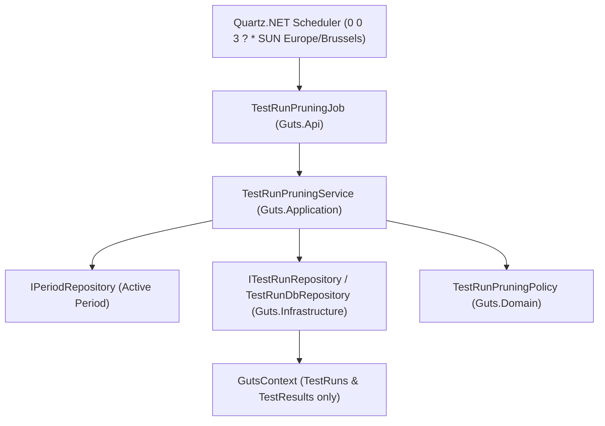

# Technical Design: Automated Pruning of Redundant Test Runs

- **Feature ID**: `010-testrun-pruning`
- **Specification**: [`spec.md`](./spec.md)
- **Status**: `Implemented`

---

## 1. Architectural Overview

`TestRunPruningJob` plugs directly into the `009-scheduled-jobs` Quartz.NET platform (zero changes to `Startup.cs`—auto-discovered via `IRecurringJob`) and delegates to `TestRunPruningService` (`Guts.Application`). All redundancy-evaluation rules live in a pure, zero-mock `TestRunPruningPolicy` in `Guts.Domain`. Persistence extends the existing `ITestRunRepository` / `TestRunDbRepository` (`Guts.Infrastructure`) with performance-oriented `AsNoTracking()` projections (pre-filtering to active-period assignments with `> 1` test run in SQL, omitting `TestResult.Message` blobs, and executing chunked `ExecuteDeleteAsync` batches for `TestResults` ➔ `TestRuns`). No database schema migrations or frontend changes are required; the job appears automatically in the Admin-only Quartz Dashboard (`/quartz`).



---

## 2. Domain Layer (`Guts.Domain`)

### Value / Snapshot Models & Domain Policy (`Guts.Domain/TestRunAggregate/`)
- **`TestResultSnapshot`** (`Guts.Domain/TestRunAggregate/TestRunPruningPolicy.cs`):
  - `public sealed record TestResultSnapshot(int TestId, bool Passed);`
- **`TestRunSnapshot`** (`Guts.Domain/TestRunAggregate/TestRunPruningPolicy.cs`):
  - `public sealed record TestRunSnapshot(int TestRunId, int UserId, DateTime CreateDateTime, IReadOnlyList<TestResultSnapshot> Results);`
- **`TestRunPruningPolicy`** (`Guts.Domain/TestRunAggregate/TestRunPruningPolicy.cs`) (`[AC-1]`, `[AC-2]`, `[DR-1]`–`[DR-4]`):
  - Pure static domain policy:
    ```csharp
    public static class TestRunPruningPolicy
    {
        public static IReadOnlyList<int> FindRedundantTestRunIds(
            IReadOnlyCollection<TestRunSnapshot> runs,
            IReadOnlyDictionary<int, int> userIdToTeamId = null);
    }
    ```
  - **Partitioning**:
    - When `userIdToTeamId != null && userIdToTeamId.TryGetValue(run.UserId, out int teamId)`: partition key is `(IsTeam: true, ScopeId: teamId)`.
    - Otherwise: partition key is `(IsTeam: false, ScopeId: run.UserId)`.
  - **Chronological Evaluation per Partition**:
    - Orders runs by `CreateDateTime ASC`, then `TestRunId ASC` (`[DR-1]`).
    - Maintains `Dictionary<int, bool> cumulativeState = []` and `bool isFirstRun = true`.
    - For each run:
      - If `run.Results == null || run.Results.Count == 0`:
        - If `isFirstRun`: keep (`isFirstRun = false`) (`[DR-3]`).
        - Else: add `run.TestRunId` to `redundantIds`.
      - Else:
        - `bool stateChanged = false;`
        - Fold each `TestResultSnapshot` in `run.Results`:
          - If `!cumulativeState.TryGetValue(result.TestId, out bool previousPassed) || previousPassed != result.Passed`:
            - `stateChanged = true;`
            - `cumulativeState[result.TestId] = result.Passed;`
        - `isFirstRun = false;`
        - If `!stateChanged`: add `run.TestRunId` to `redundantIds` (`[DR-2]`, `[DR-4]`).
  - Returns `IReadOnlyList<int>` of redundant `TestRunId`s.

---

## 3. Application Layer (`Guts.Application`) — Use-Case Orchestration Only

> [!IMPORTANT]
> Zero domain logic in `Guts.Application`. All redundancy evaluation is delegated strictly to `TestRunPruningPolicy.FindRedundantTestRunIds(...)`.

### DTOs (`Guts.Application/Dtos/`)
- **`TestRunPruningResult`** (`Guts.Application/Dtos/TestRunPruningResult.cs`):
  - `public sealed record TestRunPruningResult(int AssignmentsScanned, int TestRunsDeleted, int TestResultsDeleted);`
- **`PruningAssignmentTarget`** & **`TestRunBatchDeletionResult`** (`Guts.Application/Repositories/ITestRunRepository.cs`):
  - `public sealed record PruningAssignmentTarget(int AssignmentId, int TopicId, bool IsProject);`
  - `public sealed record TestRunBatchDeletionResult(int TestRunsDeleted, int TestResultsDeleted);`

### Expanded Repository Contract (`Guts.Application/Repositories/ITestRunRepository.cs`)
Extend existing `ITestRunRepository` with:
```csharp
Task<IReadOnlyList<PruningAssignmentTarget>> GetPruningAssignmentTargetsForPeriodAsync(
    int periodId,
    CancellationToken cancellationToken = default);

Task<IReadOnlyList<TestRunSnapshot>> GetTestRunSnapshotsForAssignmentAsync(
    int assignmentId,
    CancellationToken cancellationToken = default);

Task<IReadOnlyDictionary<int, int>> GetProjectTeamMembershipMapAsync(
    int projectId,
    CancellationToken cancellationToken = default);

Task<TestRunBatchDeletionResult> DeleteTestRunsBatchAsync(
    IReadOnlyCollection<int> testRunIds,
    CancellationToken cancellationToken = default);
```

### Application Service (`Guts.Application/Services/`)
- **Interface**: `ITestRunPruningService` (`Guts.Application/Services/ITestRunPruningService.cs`):
  - `public const int DefaultBatchSize = 500;`
  - `Task<TestRunPruningResult> PruneRedundantTestRunsAsync(int batchSize = DefaultBatchSize, CancellationToken cancellationToken = default);`
- **Implementation**: `TestRunPruningService` (`Guts.Application/Services/TestRunPruningService.cs`) (`[AC-4]`, `[AC-6]`, `[AC-7]`, `[DR-5]`):
  - Injects `IPeriodRepository`, `ITestRunRepository`, `ILogger<TestRunPruningService>`.
  - Orchestration steps:
    1. `Contracts.Require(batchSize > 0, "The pruning batch size must be a positive number.");` (`[DR-5]`).
    2. Resolve active period via `IPeriodRepository.GetPeriodAsync()` inside `try/catch (DataNotFoundException)`. If `null` or `activePeriod.IsDeleting`, log info and return `new TestRunPruningResult(0, 0, 0)`.
    3. Load active-period candidate assignment targets via `ITestRunRepository.GetPruningAssignmentTargetsForPeriodAsync(activePeriod.Id, cancellationToken)`.
    4. Maintain a per-run cache `Dictionary<int, IReadOnlyDictionary<int, int>> projectTeamMaps = []`.
    5. For each target:
       - `cancellationToken.ThrowIfCancellationRequested();`
       - Load lightweight `TestRunSnapshot`s via `GetTestRunSnapshotsForAssignmentAsync(target.AssignmentId, cancellationToken)`.
       - If `snapshots.Count <= 1`: continue.
       - If `target.IsProject`: fetch or reuse `projectTeamMaps[target.TopicId]`.
       - Evaluate `IReadOnlyList<int> redundantIds = TestRunPruningPolicy.FindRedundantTestRunIds(snapshots, teamMap)`.
       - Chunk `redundantIds` using `.Chunk(batchSize)` and call `DeleteTestRunsBatchAsync(batch, cancellationToken)` for each chunk, accumulating `totalRunsDeleted` and `totalResultsDeleted`.
    6. Log structured summary (`PeriodId`, `AssignmentsScanned`, `TestRunsDeleted`, `TestResultsDeleted`, elapsed ms) and return `TestRunPruningResult`.

---

## 4. Infrastructure Layer (`Guts.Infrastructure`)

### EF Core Configuration & Migrations
- **Migration Required?**: `No` — operates strictly on existing `TestRuns`, `TestResults`, `Assignments`, `Topics`, `Courses`, `Periods`, and `ProjectTeamUsers` tables.

### Expanded Repository (`Guts.Infrastructure/Repositories/TestRunDbRepository.cs`)
Expand the existing `TestRunDbRepository` (keeping performance first):
- **`GetPruningAssignmentTargetsForPeriodAsync(int periodId, CancellationToken)`**:
  - Queries `_context.Assignments.AsNoTracking()` where `a.Topic.PeriodId == periodId && !a.Topic.Period.IsDeleting && !a.Topic.Course.IsDeleting && a.TestRuns.Count > 1`.
  - Pre-filtering `a.TestRuns.Count > 1` in SQL skips untouched or single-run assignments immediately with zero extra queries.
  - Projects `new PruningAssignmentTarget(a.Id, a.TopicId, a.Topic is Project)` ordered by `a.Id`.
- **`GetTestRunSnapshotsForAssignmentAsync(int assignmentId, CancellationToken)`**:
  - Executes two lean, narrow `AsNoTracking()` queries (avoiding `TestResult.Message` `nvarchar(max)` blobs, avoiding EF change-tracker overhead, and avoiding SQL Cartesian joins):
    1. `runs`: `_context.TestRuns.AsNoTracking().Where(r => r.AssignmentId == assignmentId).Select(r => new { r.Id, r.UserId, r.CreateDateTime }).ToListAsync(ct)`.
    2. If `runs.Count <= 1`, returns early without querying `TestResults`.
    3. `results`: `_context.TestResults.AsNoTracking().Where(tr => tr.TestRun.AssignmentId == assignmentId).Select(tr => new { tr.TestRunId, tr.TestId, tr.Passed }).ToListAsync(ct)`.
  - Groups results in memory via `ToLookup(r => r.TestRunId)` and builds `List<TestRunSnapshot>`.
- **`GetProjectTeamMembershipMapAsync(int projectId, CancellationToken)`**:
  - Queries `_context.ProjectTeamUsers.AsNoTracking().Where(ptu => ptu.ProjectTeam.ProjectId == projectId).Select(ptu => new { ptu.UserId, ptu.ProjectTeamId }).ToListAsync(ct)` and populates a `Dictionary<int, int>` via `TryAdd`.
- **`DeleteTestRunsBatchAsync(IReadOnlyCollection<int> testRunIds, CancellationToken)`**:
  - If `testRunIds == null || testRunIds.Count == 0`, returns `new TestRunBatchDeletionResult(0, 0)`.
  - Uses set-based `ExecuteDeleteAsync` (zero entity loading/change-tracking), deleting child `TestResults` first to satisfy `DeleteBehavior.Restrict`:
    ```csharp
    int resultsDeleted = await _context.TestResults
        .Where(tr => testRunIds.Contains(tr.TestRunId))
        .ExecuteDeleteAsync(cancellationToken);

    int runsDeleted = await _context.TestRuns
        .Where(r => testRunIds.Contains(r.Id))
        .ExecuteDeleteAsync(cancellationToken);
    ```
  - Never touches `TestCodeHash` or `SolutionFiles` (`[AC-3]`).

---

## 5. API Layer (`Guts.Api`)

### Quartz Recurring Job (`Guts.Api/ScheduledJobs/Jobs/TestRunPruningJob.cs`)
- **`TestRunPruningJob`** (`[AC-5]`):
  - Decorated with `[DisallowConcurrentExecution]`, implements `IRecurringJob`:
    - `JobName => "TestRunPruning"`
    - `Description => "Prunes redundant TestRuns and TestResults in the active academic period that delivered no change in cumulative pass/fail test outcomes."`
    - `DefaultCronExpression => "0 0 3 ? * SUN"`
    - `MisfirePolicy => MisfirePolicy.FireAndProceed`
    - `MaxRetries => 3`
    - `RetryDelay => TimeSpan.FromMinutes(15)`
  - Constructor injects `ITestRunPruningService`, `IConfiguration`, `ILogger<TestRunPruningJob>`.
  - `Execute(IJobExecutionContext context, CancellationToken cancellationToken = default)`:
    - Reads `int batchSize = configuration.GetValue<int?>("TestRunPruning:BatchSize") ?? ITestRunPruningService.DefaultBatchSize;`.
    - Calls `TestRunPruningResult result = await pruningService.PruneRedundantTestRunsAsync(batchSize, cancellationToken);`.
    - Logs summary completion.
- **Configuration (`Backoffice/Guts.Api/appsettings.json`)**:
  - Add `"TestRunPruning": { "Enabled": true, "CronExpression": "0 0 3 ? * SUN" }` under `ScheduledJobs:Jobs`.
  - Add `"TestRunPruning": { "BatchSize": 500 }`.
- **No changes to `Startup.cs`** — `AddScheduledJobs` auto-discovers `TestRunPruningJob` by convention!

---

## 6. Frontend Layer (`Guts.Web/ClientApp`)

No frontend changes required. `TestRunPruningJob` automatically appears in the Admin-only Quartz Dashboard (`/quartz`) with full visibility, pause/resume, execution history, and manual "Trigger Now" support.

---

## 7. Dependency Injection (`Guts.Bootstrapper`)

All components match existing auto-registration conventions in `StartUpExtensions.cs` and `ScheduledJobsServiceCollectionExtensions.cs`—**zero manual DI wiring required**:
- `TestRunPruningService` implements `ITestRunPruningService` in `Guts.Application` (ends with `Service` ➔ Scoped).
- `TestRunDbRepository` already implements `ITestRunRepository` in `Guts.Infrastructure` (ends with `Repository` ➔ Scoped).
- `TestRunPruningJob` implements `IRecurringJob` in `Guts.Api` (auto-discovered by `AddScheduledJobs`).
