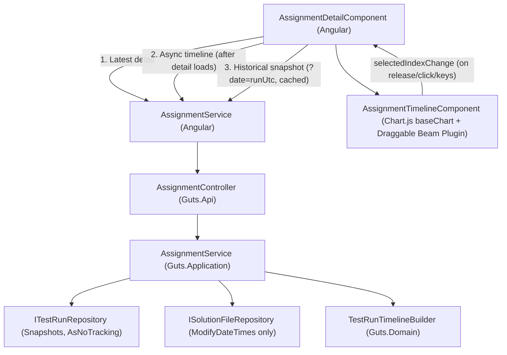

# Technical Design: Interactive Test Run Timeline (Time-Travel Inspection)

- **Feature ID**: `011-testrun-timeline`
- **Specification**: [`spec.md`](./spec.md)
- **Status**: `Implemented`

---

## 1. Architectural Overview

The Interactive Test Run Timeline spans all layers cleanly without adding new database tables or repositories:
- **`Guts.Domain`**: `TestRunTimelineBuilder` (pure, zero-mock domain service) reuses `TestRunSnapshot` / `TestResultSnapshot` (from `010-testrun-pruning`) to compute cumulative pass/fail progression, test-result change flags/deltas, and `SolutionFile` correlation.
- **`Guts.Application`**: Expands `IAssignmentService` / `AssignmentService`, `ITestRunRepository`, and `ISolutionFileRepository` with lean read-only timeline queries.
- **`Guts.Infrastructure`**: Implements `AsNoTracking()` projections on `TestRunDbRepository` and `SolutionFileDbRepository` (never loading `TestResult.Message` or `SolutionFile.Content`).
- **`Guts.Api`**: Exposes `GET /api/assignments/{id}/foruser/{userId}/timeline` and `.../forteam/{teamId}/timeline` on `AssignmentController` with identical role/ownership authorization as the existing detail endpoints.
- **`Guts.Web/ClientApp`**: Introduces a standalone interactive **Chart.js** (`ng2-charts` `BaseChartDirective`) `AssignmentTimelineComponent` with a custom draggable vertical beam plugin and updates `AssignmentDetailComponent` to perform two-stage async loading, in-memory snapshot caching, and expanded source-code panel preservation while time-traveling.



---

## 2. Domain Layer (`Guts.Domain`)

### Domain Types & Pure Builder (`Guts.Domain/TestRunAggregate/TestRunTimelineBuilder.cs`)
- Reuses existing `TestRunSnapshot` and `TestResultSnapshot` records (`Guts.Domain/TestRunAggregate/TestRunPruningPolicy.cs`).
- **`TestRunTimelinePoint`** (immutable record):
  ```csharp
  public sealed record TestRunTimelinePoint(
      int TestRunId,
      int RunNumber,
      DateTime CreateDateTimeUtc,
      int PassedTestsCount,
      int FailedTestsCount,
      int TotalTestsCount,
      bool TestResultsChanged,
      bool SolutionFilesChanged,
      int TestResultsDelta);
  ```
- **`TestRunTimelineBuilder`** (`[AC-2]`, `[DR-1]`–`[DR-4]`):
  - `public static readonly TimeSpan SolutionFileCorrelationTolerance = TimeSpan.FromSeconds(2);`
  - `public static IReadOnlyList<TestRunTimelinePoint> Build(IReadOnlyCollection<TestRunSnapshot> runs, IReadOnlyCollection<DateTime> solutionFileModifyDateTimesUtc, int totalTestsCount)`:
    1. If `runs == null || runs.Count == 0`, returns `[]`.
    2. Orders `runs` strictly by `(CreateDateTime ASC, TestRunId ASC)` (`[DR-1]`).
    3. Orders `solutionFileModifyDateTimesUtc` ascending (normalizing to UTC) and walks a single index pointer `fileIndex`:
       - For each run `r`, any file timestamp with `modifyTime <= r.CreateDateTime + SolutionFileCorrelationTolerance` is consumed and sets `solutionFilesChanged = true` for `r` (`[DR-3]`).
    4. Maintains `Dictionary<int, bool> cumulativeState = []` (`TestId -> Passed`) and `int previousPassedCount = 0`:
       - Folds `r.Results` into `cumulativeState`: `testResultsChanged = true` if any `TestId` is newly added or its `Passed` flag flipped (`[DR-2]`).
       - Computes `passedTestsCount = cumulativeState.Values.Count(p => p)` and `failedTestsCount = cumulativeState.Values.Count(p => !p)`.
       - `testResultsDelta = runNumber == 1 ? 0 : passedTestsCount - previousPassedCount`.
       - `previousPassedCount = passedTestsCount`.
    5. Returns the ordered `IReadOnlyList<TestRunTimelinePoint>`.

---

## 3. Application Layer (`Guts.Application`) — Use-Case Orchestration Only

> [!IMPORTANT]
> Zero domain logic in `Guts.Application`. All timeline progression and correlation logic is delegated strictly to `TestRunTimelineBuilder.Build(...)`.

### DTO (`Guts.Application/Dtos/AssignmentTimelineDto.cs`)
```csharp
public sealed record AssignmentTimelineDto(
    int AssignmentId,
    int TotalTestsCount,
    IReadOnlyList<TestRunTimelinePoint> Runs);
```

### Expanded Repository Contracts (`Guts.Application/Repositories/`)
- **`ITestRunRepository`**:
  - `Task<IReadOnlyList<TestRunSnapshot>> GetUserTestRunSnapshotsForAssignmentAsync(int assignmentId, int userId, DateTime? dateUtc);`
  - `Task<IReadOnlyList<TestRunSnapshot>> GetTeamTestRunSnapshotsForAssignmentAsync(int assignmentId, int teamId, DateTime? dateUtc);`
- **`ISolutionFileRepository`**:
  - `Task<IReadOnlyList<DateTime>> GetModifyDateTimesForUserAsync(int assignmentId, int userId, DateTime? dateUtc);`
  - `Task<IReadOnlyList<DateTime>> GetModifyDateTimesForTeamAsync(int assignmentId, int teamId, DateTime? dateUtc);`

### Expanded Application Service (`Guts.Application/Services/`)
- **`IAssignmentService` / `AssignmentService`**:
  - `Task<AssignmentTimelineDto> GetTimelineForUserAsync(int assignmentId, int userId, int totalTestsCount, DateTime? dateUtc);`
  - `Task<AssignmentTimelineDto> GetTimelineForTeamAsync(int assignmentId, int teamId, int totalTestsCount, DateTime? dateUtc);`
  - Orchestration:
    1. Fetch `TestRunSnapshot`s from `ITestRunRepository`.
    2. If `runs.Count == 0`, return `new AssignmentTimelineDto(assignmentId, totalTestsCount, [])` without querying `SolutionFiles`.
    3. Fetch `ModifyDateTime` timestamps from `ISolutionFileRepository`.
    4. Invoke `TestRunTimelineBuilder.Build(runs, modifyDateTimes, totalTestsCount)` and return `AssignmentTimelineDto`.

---

## 4. Infrastructure Layer (`Guts.Infrastructure`)

### EF Core Configuration & Migrations
- **Migration Required?**: `No`.

### Expanded Repositories (`Guts.Infrastructure/Repositories/`)
- **`TestRunDbRepository`**:
  - `GetUserTestRunSnapshotsForAssignmentAsync(assignmentId, userId, dateUtc)`:
    - Two narrow `AsNoTracking()` queries (omitting `TestResult.Message`):
      1. `TestRuns` filtered by `AssignmentId == assignmentId && UserId == userId && (dateUtc == null || CreateDateTime <= dateUtc)` projecting `(Id, UserId, CreateDateTime)`.
      2. `TestResults` filtered by matching `TestRunId`s (via join/predicate on `TestRun.AssignmentId == assignmentId && TestRun.UserId == userId && ...`) projecting `(TestRunId, TestId, Passed)`.
    - Grouped via `ToLookup` into `TestRunSnapshot`s.
  - `GetTeamTestRunSnapshotsForAssignmentAsync(assignmentId, teamId, dateUtc)`:
    - Same two-query `AsNoTracking()` pattern joined against `ProjectTeamUsers` for `ProjectTeamId == teamId`.
- **`SolutionFileDbRepository`**:
  - `GetModifyDateTimesForUserAsync(assignmentId, userId, dateUtc)`:
    - `FilterByAssignmentAndDate(assignmentId, dateUtc).AsNoTracking().Where(sf => sf.UserId == userId).Select(sf => sf.ModifyDateTime).ToListAsync()`.
  - `GetModifyDateTimesForTeamAsync(assignmentId, teamId, dateUtc)`:
    - `FilterByTeam(FilterByAssignmentAndDate(assignmentId, dateUtc), teamId).AsNoTracking().Select(sf => sf.ModifyDateTime).ToListAsync()`.
  - Never selects `SolutionFile.Content`!

---

## 5. API Layer (`Guts.Api`)

### Response Models (`Guts.Api/Models/AssignmentTimelineModel.cs`)
- **`AssignmentTimelineModel`**: `AssignmentId`, `TotalTestsCount`, `IReadOnlyList<AssignmentTimelinePointModel> Runs`.
- **`AssignmentTimelinePointModel`**: `TestRunId`, `RunNumber`, `CreateDateTimeUtc`, `PassedTestsCount`, `FailedTestsCount`, `TotalTestsCount`, `TestResultsChanged`, `SolutionFilesChanged`, `TestResultsDelta`.

### REST Endpoints (`Guts.Api/Controllers/AssignmentController.cs`)
- `GET /api/assignments/{assignmentId}/foruser/{userId}/timeline?date={optionalDate}` (`[AC-6]`):
  - Same auth guard as `GetAssignmentResultsForUser` (Student: `IsOwnUserId(userId)`, else `IsLector()`, else `Forbid()`).
  - Loads assignment via `assignmentRepository.GetSingleWithTestsAndCourseAsync(assignmentId)` to obtain `assignment.Tests.Count`.
  - Calls `assignmentService.GetTimelineForUserAsync(assignmentId, userId, assignment.Tests.Count, date?.ToUniversalTime())` and maps to `AssignmentTimelineModel`.
- `GET /api/assignments/{assignmentId}/forteam/{teamId}/timeline?date={optionalDate}` (`[AC-6]`):
  - Same auth guard as `GetAssignmentResultsForTeam` (loads team via `projectTeamRepository.LoadByIdAsync(teamId)`; Student must be member, else `IsLector()`, else `Forbid()`).
  - Loads assignment via `assignmentRepository.GetSingleWithTestsAndCourseAsync(assignmentId)` and calls `assignmentService.GetTimelineForTeamAsync(assignmentId, teamId, assignment.Tests.Count, date?.ToUniversalTime())`.

---

## 6. Frontend Layer (`Guts.Web/ClientApp`)

### ViewModels & Pure Helpers (`src/app/viewmodels/assignment-timeline.model.ts`)
- `IAssignmentTimelinePointModel`, `IAssignmentTimelineModel`, `TimelineScaleMode = "sequence" | "realtime"`, `TimelineDotTier = "test-improved" | "test-regressed" | "test-neutral" | "code-only" | "unchanged"`.
- Pure exported helper functions (for crisp unit testing):
  - `classifyTimelineDot(point: IAssignmentTimelinePointModel): TimelineDotTier`
  - `getTimelineChangeSummary(point: IAssignmentTimelinePointModel): string`
  - `getTimelinePointXValue(runs: IAssignmentTimelinePointModel[], index: number, scaleMode: TimelineScaleMode): number` (returns `index` in `"sequence"` mode or UTC timestamp ms in `"realtime"` mode, falling back safely to `index` if all timestamps are identical).
  - `findNearestRunIndex(runs: IAssignmentTimelinePointModel[], xValue: number, scaleMode: TimelineScaleMode): number` (snaps pointer/click X value to nearest run index).

### Service (`src/app/services/assignment.service.ts`)
- Add `getAssignmentTimeline(assignmentId: number, userId: number, teamId: number, date?: Date | string): Observable<GetResult<IAssignmentTimelineModel>>` calling `api/assignments/${assignmentId}/foruser/${userId}/timeline` or `.../forteam/${teamId}/timeline` with optional `?date=...`.

### Components
1. **`AssignmentTimelineComponent`** (standalone component in `src/app/components/assignment-timeline/`, importing `BaseChartDirective` from `ng2-charts`, imported in `AppModule`):
   - **Inputs**: `timeline: IAssignmentTimelineModel`, `selectedIndex: number`.
   - **Outputs**: `selectedIndexChange: EventEmitter<number>`.
   - **Chart.js Line Graph (`<canvas baseChart [type]="'line'" [data]="chartData" [options]="chartOptions" [plugins]="chartPlugins">`)**:
     - **Dataset**: `{ x, y }[]` progression curve (`y = passedTestsCount`, subtle area fill, `tension: 0`) using per-point styling arrays (`pointRadius`, `pointHoverRadius`, `pointBackgroundColor`, `pointBorderColor`, `pointBorderWidth`) computed from `classifyTimelineDot`:
       - `test-improved` (`r=6.5`, solid green `#198754`, white border)
       - `test-regressed` (`r=6.5`, solid red `#dc3545`, white border)
       - `test-neutral` (`r=6.5`, solid blue `#0d6efd`, white border — first run or neutral test change)
       - `code-only` (`r=5.5`, white fill `#ffffff`, `#f59e0b` amber stroke `width=2.5`)
       - `unchanged` (`r=3.5`, muted gray `#adb5bd`)
     - **X-axis (`type: "linear"`)**:
       - In `Sequence` mode: `min: 0`, `max: runs.length - 1`, integer ticks formatted as the run's local timestamp (no extra Chart.js date adapter package needed).
       - In `Real-time` mode: `min: firstMs`, `max: lastMs` (falling back safely to `Sequence` if `firstMs === lastMs`), ticks formatted as local date/time.
     - **Y-axis**: `min: 0`, `max: Math.max(totalTestsCount, 1)`, integer step ticks (`precision: 0`).
     - **Tooltips**: Rich Chart.js hover tooltips displaying `Run #N of Total`, local timestamp, `passed / total passed`, and `getTimelineChangeSummary(point)`.
     - **Custom Chart.js Beam Plugin (`afterDatasetsDraw`)**:
       - Draws a subtle dimmed overlay over the "future" region (`x > beamPixelX`) when scrubbing into the past.
       - Draws the vertical accent beam line at `xScale.getPixelForValue(activeX)` plus a pill grab handle at the top of the chart area.
     - **Interactive Pointer Dragging & Accessibility**:
       - Pointer events (`pointerdown` + `setPointerCapture`, `pointermove`, `pointerup`) on the chart container convert pointer X into `xScale.getValueForPixel(offsetX)` ➔ `findNearestRunIndex(...)` ➔ updates `previewIndex` and calls `chart.draw()` smoothly without firing HTTP requests until release (`pointerup`) or click!
       - Container carries `role="slider"`, `tabindex="0"`, `aria-valuemin="1"`, `aria-valuemax`, `aria-valuenow`, `aria-valuetext` with keyboard support (`ArrowLeft`, `ArrowRight`, `Home`, `End`).
       - Header controls: `◀ Prev` / `Next ▶` buttons, `Sequence` / `Real-time` scale toggle, concise 3-tier dot legend, and live readout bar (`Run #N of Total · formatted timestamp · X/Y passed · Change badge`).
2. **`AssignmentDetailComponent`** (`src/app/components/assignmentdetail/`):
   - **Two-stage async flow** (with `Subscription` / `switchMap` cancellation on `@Input()` change):
     1. Load latest detail via `getAssignmentDetail(assignmentId, userId, teamId, statusDate)`.
     2. Render immediately (`loading = false`).
     3. If `model.numberOfRuns > 1`, set `timelineLoading = true` and call `getAssignmentTimeline(assignmentId, userId, teamId, statusDate)`.
     4. On timeline success: store `timeline`, set `selectedRunIndex = runs.length - 1`, seed `snapshotCache` with the already-loaded latest detail under `runs[runs.length - 1].testRunId`.
     5. On timeline error: set `timelineError = result.message || "Could not load test run timeline."` (non-blocking).
   - **Time-travel selection (`onTimelineRunSelected(index)`)**:
     - Captures `expandedFilePaths = new Set(model.solutionFiles.filter(f => !f.isCollapsed).map(f => f.filePath))`.
     - If `snapshotCache.has(run.testRunId)`: restores immediately and re-applies `expandedFilePaths`.
     - Else sets `loading = true`, calls `getAssignmentDetail(assignmentId, userId, teamId, run.createDateTimeUtc)`, caches the `IAssignmentDetailModel`, applies `expandedFilePaths`, and sets `loading = false`.
   - **Historical Banner**:
     - When `isViewingHistoricalRun` (`timeline && selectedRunIndex < timeline.runs.length - 1`), displays an info banner (`Viewing historical snapshot: Run #X of N — [timestamp]`) with a **"Back to latest"** button calling `backToLatest()`.

---

## 7. Dependency Injection (`Guts.Bootstrapper`)

Zero manual DI registration changes required—all methods are added to existing auto-registered interfaces/classes (`AssignmentService`, `TestRunDbRepository`, `SolutionFileDbRepository`).
